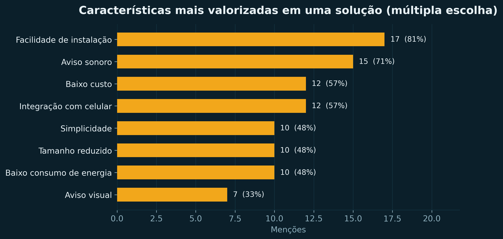

<div align="center">

# Detector de Vazamento de Gás com MSP430

**Um sistema embarcado de baixo custo que transforma a presença de gás em um evento detectável eletronicamente — som, luz e texto — em vez de depender só do olfato humano.**

[](https://www.ti.com/tool/MSP-EXP430F5529LP)
[](firmware/)
[](LICENSE)
[](#contexto-acadêmico)

<sub>Victor Hugo Guimarães Nascimento · Davi Sousa da Vinha</sub>
<sub>Universidade de Brasília — Faculdade de Tecnologia — 2026/1</sub>

</div>

---

## Índice

- [O problema](#o-problema)
- [A solução em uma imagem](#a-solução-em-uma-imagem)
- [Demonstração interativa](#demonstração-interativa)
- [Números da pesquisa de campo](#números-da-pesquisa-de-campo)
- [Hardware](#hardware)
- [Como o firmware funciona](#como-o-firmware-funciona)
- [Estrutura do repositório](#estrutura-do-repositório)
- [Como compilar, gravar e testar](#como-compilar-gravar-e-testar)
- [Bugs corrigidos no código original](#bugs-corrigidos-no-código-original)
- [Limitações e honestidade técnica](#limitações-e-honestidade-técnica)
- [Aprendizados](#aprendizados)
- [Documentação completa](#documentação-completa)
- [Contexto acadêmico](#contexto-acadêmico)
- [Licença](#licença)

---

## O problema

Tudo começou com um **relato real**, ouvido durante a pesquisa de campo com moradores de um condomínio:

> Uma moradora contou que **não consegue perceber cheiro de gás**. Houve um vazamento no fogão da casa dela que ficou **sem ser identificado por um período** — e só foi descoberto quando o técnico foi trocar o botijão.

Esse caso expõe uma dependência silenciosa: no Brasil, a detecção de vazamento de gás em casa é, na prática, **o nariz humano**. E o olfato falha exatamente quando mais importa — em idosos, em pessoas com limitações sensoriais, em quem está distraído, dormindo, ou simplesmente fora da cozinha.

A pesquisa de campo confirmou a hipótese com dados. Não era um problema de uma pessoa: era um **ponto cego coletivo**.

## A solução em uma imagem

Um sistema embarcado simples e barato, construído sobre a **LaunchPad MSP430F5529LP**:

```
                 ┌──────────────────────────────────────────────┐
                 │        MSP430F5529LP  (LaunchPad)            │
                 │                                              │
   MQ-2          │   ┌──────────┐      ┌────────────────────┐   │
   sensor  ──────┼──►│  ADC12   │─────►│  Lógica de decisão │   │
   de gás        │   │  canal   │      │  leitura > limiar? │   │
   (analógico)   │   │   A0     │      └─────┬────────┬─────┘   │
                 │   │  P6.0    │            │        │         │
                 │   └──────────┘            │        │         │
                 │                           ▼        ▼         │
                 │                      ┌────────┐ ┌────────┐   │
                 │              PWM ───►│ Buzzer │ │  LED1  │   │
                 │                      └────────┘ └────────┘   │
                 │                           │                  │
                 │   LCD 16x2 ◄── I2C ───────┘                  │
                 │   (SDA P3.0 / SCL P3.1)                      │
                 │                                              │
                 │   Botão S2 ──► silencia o som (mantém LED)   │
                 └──────────────────────────────────────────────┘
```

**O ciclo é curto e legível:**

1. O **MQ-2** entrega uma tensão analógica proporcional à concentração de gás inflamável no ar.
2. O **ADC12** do MSP430 converte para um número de 0 a 4095.
3. O firmware compara com um **limiar calibrado** (1500 na bancada).
4. Acima do limiar → **buzzer** tocando, **LED** aceso, **LCD** escrito `ALERTA DE GAS!`.
5. Abaixo → **ambiente seguro**, tudo desligado, e o alarme se **rearma** sozinho.
6. O **botão** silencia o som durante a verificação — mas o LED continua indicando o risco.

> **Decisão de projeto deliberada:** o botão silencia o *som*, nunca a *indicação*. Se o gás continua acima do limiar, a luz continua acesa e o LCD continua dizendo que há alerta. O usuário pode ficar sem o incômodo sonoro, mas não sem a informação.

## Demonstração interativa

O projeto vem com uma **página de apresentação standalone** que reproduz o comportamento do firmware no navegador — sem precisar da placa na mão:

```
web/index.html   ← abra com duplo clique
```

Ela inclui um **simulador com slider de 0 a 4095** que atualiza em tempo real o display LCD 16x2, o LED, o estado do buzzer e o percentual relativo ao limiar, seguindo exatamente as mesmas regras do firmware (limiar 1500, modo mutado, rearme automático). O som só é ativado depois de um clique seu — nada de sustos ao abrir a página.

A página foi construída para ser **encaixável em um site pessoal** (iframe, cópia da pasta ou HTML exportado) e funciona offline, sem servidor e sem dependências de rede. Detalhes em [`web/README.md`](web/README.md).

## Números da pesquisa de campo

Pesquisa aplicada em **maio de 2026** com moradores de um condomínio (entrevistas) e público externo (formulário digital na plataforma Tally): **21 respostas**, 12 perguntas.

| Indicador | Resultado | O que isso significa para o projeto |
| :--- | :---: | :--- |
| Usam botijão de gás | **86%** | O cenário é o do GLP residencial, não o de gás encanado |
| Usam o fogão várias vezes ao dia | **86%** | Risco convive com a rotina, não é evento raro |
| Já presenciaram ou suspeitaram de vazamento | **52%** | Mais da metade já viveu a situação de perto |
| **Não** possuem detector automático | **95%** | Praticamente não existe detecção eletrônica nessas casas |
| Identificariam vazamento **pelo cheiro** | **100%** | O olfato é *o* método — unanimidade absoluta |
| Dizem que só o cheiro **não basta** sempre | **81%** | As próprias pessoas desconfiam do seu único método |
| Querem o alarme audível **em outros cômodos** | **95%** | Justifica o alerta sonoro de verdade, não um bip discreto |
| Acham um **botão de silenciar** útil | **71%** | O botão não é enfeite: é requisito pedido pelo público |
| Preferem **combinação** de alertas (som + luz) | **62%** | Justifica a redundância som + LED + LCD |

O gráfico abaixo ilustra a contradição central da pesquisa: **todos** usam o cheiro como método, e **quase todos** admitem que ele falha.


**Como cada resposta virou requisito de engenharia:**

| Evidência da pesquisa | Decisão no firmware/hardware |
| :--- | :--- |
| 100% dependem do cheiro; 81% sabem que ele falha | Detecção **eletrônica**, independente de percepção humana |
| 62% querem combinação de alertas; 95% querem ouvir de longe | **Som + luz + texto** ao mesmo tempo (redundância intencional) |
| 71% acham o botão útil | **Silenciamento temporário** sem apagar a indicação de risco |
| Locais mais citados: cozinha (62%), botijão, fogão | **Instalação junto à fonte** — posicionamento orientado por dado |
| Top características: facilidade de instalação (17), aviso sonoro (15), baixo custo (12) | **Montagem simples** com componentes acessíveis |
| Integração com celular também citada (12) | Ficou **fora do escopo** — registrado como limitação, não escondido |

<table>
<tr>
<td width="50%">


</td>
<td width="50%">



</td>
</tr>
</table>

> Análise completa, reprodutível e com todos os cruzamentos: [`analysis/out/analise.md`](analysis/out/analise.md) — gerada pelo script [`analysis/analisar_pesquisa.py`](analysis/analisar_pesquisa.py) a partir do CSV em [`data/`](data/). Nenhum número deste README foi digitado à mão: todos saem do script.

**🔒 Privacidade dos participantes.** O CSV publicado em [`data/`](data/) está **anonimizado**: as colunas de controle do formulário (`Submission ID`, `Respondent ID` e a data/hora de cada envio) foram removidas antes do commit, e as respostas foram mantidas integralmente para preservar a reprodutibilidade. Isso está documentado em [`data/README.md`](data/README.md) e é executado por [`analysis/anonimizar_csv.py`](analysis/anonimizar_csv.py).

## Hardware

| Componente | Função no projeto | Custo estimado |
| :--- | :--- | ---: |
| LaunchPad **MSP430F5529LP** | Microcontrolador principal: ADC, decisão e controle dos alertas | R$ 150,00 |
| Sensor de gás **MQ-2** | Detecção de gás inflamável por saída analógica | R$ 15,00 – 25,00 |
| **Buzzer** ativo ou passivo | Alerta sonoro | R$ 5,00 – 10,00 |
| **LED1** da LaunchPad | Alerta visual (já incluso na placa, P1.0) | incluso |
| **LCD 16x2** (com módulo I2C) | Estado do sistema e leitura relativa ao limiar | R$ 15,00 – 30,00 |
| Resistores | Condicionamento de sinal e acionamento do buzzer | R$ 0,40 |
| Protoboard e jumpers | Montagem e interligação | R$ 20,00 |
| | **Total estimado** | **R$ 205,40 – 235,40** |

**Pinagem** — todos os pinos, limiares e tempos vivem em um único arquivo, [`firmware/include/config.h`](firmware/include/config.h):

| Sinal | Pino no MSP430 | Observação |
| :--- | :--- | :--- |
| Saída analógica do sensor | **P6.0 / A0** | Entrada do ADC12 |
| LED1 da LaunchPad | **P1.0** | Saída digital já ligada ao LED da placa |
| Buzzer | **P2.4 / TA2.2** | PWM via timer; transistor de acionamento se necessário |
| Botão de silenciamento | **P2.1** | Pull-up interno + interrupção de porta (`P2IV == 0x04`) |
| LCD 16x2 | **P3.0 / SDA** e **P3.1 / SCL** | Interface I2C, pull-ups em 3,3 V |
| GND do sensor e periféricos | **GND** | Referência comum obrigatória |

⚠️ **Atenção elétrica:** o MSP430F5529 opera em **3,3 V**. A entrada do ADC não pode receber tensão acima disso. Se o módulo do sensor for alimentado em 5 V, use um **divisor resistivo** (por exemplo 10 kΩ / 18 kΩ, que reduz 5 V para ≈3,21 V) antes de ligar em P6.0. O mesmo vale para os pull-ups do módulo I2C do LCD: devem ir para **3,3 V**, nunca 5 V.

> O relatório teórico do projeto especifica buzzer em **P2.0/TA1.1** e botão **S2 em P1.1**. A implementação real, que é o padrão deste repositório, usa **P2.4/TA2.2** e **P2.1**. A divergência está documentada em [`docs/engenharia.md`](docs/engenharia.md) e é reversível alterando `config.h` — não foi "corrigida" para não alterar um protótipo que foi efetivamente montado e funcionou.

## Como o firmware funciona

O código foi organizado em módulos com responsabilidades separadas, em vez de um único arquivo:

| Módulo | Responsabilidade |
| :--- | :--- |
| `config.h` | Todos os pinos, limiares e tempos em um só lugar |
| `adc.c` | Configuração e leitura do ADC12 (canal A0) |
| `i2c.c` | Camada de baixo nível do barramento I2C (mestre, polling, tratamento de NACK) |
| `lcd.c` | Driver do LCD 16x2 em modo 4 bits via PCF8574 |
| `buzzer.c` | Timer A2 em modo PWM para gerar o tom |
| `botao.c` | Interrupção de porta com tratamento de repique |
| `app.c` | **A lógica de decisão** — onde mora a regra de negócio |
| `main.c` | Apenas orquestra: configura, inicializa e roda o laço |

O trecho abaixo é o coração do sistema (versão modular; o arquivo original do projeto está preservado em [`firmware/original/`](firmware/original/)):

```c
/* app.c — decisão de alarme, sem depender de hardware */
estado_alarme_t app_avaliar_leitura(uint16_t nivel_adc, uint8_t *mutado)
{
    estado_alarme_t estado;

    if (nivel_adc > LIMIAR_GAS_ADC) {
        /* acima do limiar: risco detectado */
        estado = (*mutado) ? ALARME_MUTADO : ALARME_ATIVO;
    } else {
        /* voltou ao normal: rearma o silenciamento automaticamente */
        *mutado = 0;
        estado = AMBIENTE_SEGURO;
    }
    return estado;
}
```

Essa separação tem um motivo prático: **a regra de decisão pode ser testada em um PC**, sem MSP430, sem bancada e sem sensor. É o que o diretório [`firmware/sim/`](firmware/sim/) faz — reproduz a mesma lógica de decisão e roda casos de teste (abaixo do limiar, exatamente no limiar, acima, silenciado, rearme após queda, formatação das 16 colunas do LCD).

**Periféricos exercitados** — cada um é conteúdo direto da disciplina:

`GPIO` · `Interrupções de porta` · `Timer A2 (PWM)` · `ADC12 (conversão A/D)` · `I2C (comunicação digital)` · `Comparação de limiares` · `Máquina de estados de alarme`

## Estrutura do repositório

```
gas-leak-detector-msp430/
├── firmware/                 Firmware do MSP430
│   ├── include/              config.h e cabeçalhos dos módulos
│   ├── src/                  adc, i2c, lcd, buzzer, botao, app, main
│   ├── original/             O sketch original, preservado como referência
│   ├── sim/                  Simulador da lógica + testes (roda no PC)
│   ├── Makefile              Build para msp430-elf-gcc
│   └── README.md             Pinagem, build, gravação, bugs corrigidos
├── web/                      Página de apresentação interativa
│   ├── index.html            Standalone, offline, pronta para o site pessoal
│   └── assets/img/           Gráficos e imagens usados na página
├── analysis/                 Análise reprodutível da pesquisa
│   ├── analisar_pesquisa.py  Script que lê o CSV e gera tudo
│   └── out/                  Gráficos (PNG 300 dpi) + analise.md
├── data/                     Dados brutos e agregados
│   ├── pesquisa_vazamento_gas.csv
│   └── survey.json
├── docs/                     Documentação do projeto
│   ├── relatorio.md          Relatório acadêmico completo
│   ├── engenharia.md         Arquitetura, fórmulas, pinagem
│   ├── pesquisa.md           Pesquisa de campo
│   ├── BUGS_E_MELHORIAS.md   O que foi corrigido e o que ficou para depois
│   └── figures/              Figuras originais + analíticas
├── report/                   Relatório em LaTeX + PDF compilado
├── hardware/                 Lista de materiais e diagrama
└── README.md
```

## Como compilar, gravar e testar

**Pré-requisito** para o alvo MSP430: toolchain da TI (`msp430-elf-gcc` + `msp430-gcc-support-files`). Ele **não** vem junto com este repositório.

```bash
cd firmware

make            # compila o firmware para o MSP430F5529
make clean      # limpa artefatos
make sim        # compila e roda a simulação da lógica no seu PC
```

Para gravar na placa, use o **Code Composer Studio** ou o **MSP430 Flasher** da TI, apontando para o `.elf`/`.out` gerado.

> **Transparência:** o toolchain do MSP430 não estava disponível no ambiente onde este repositório foi organizado, então **o firmware não foi recompilado aqui** — o que foi executado e validado foram os testes da lógica de decisão em [`firmware/sim/`](firmware/sim/). Veja os detalhes e a saída dos testes em [`firmware/README.md`](firmware/README.md).

**Rodar a análise da pesquisa** (funciona de verdade, sem placa e sem hardware):

```bash
python analysis/analisar_pesquisa.py
# gera data/survey.json, analysis/out/*.png e analysis/out/analise.md
```

## Bugs corrigidos no código original

O sketch original funcionava — mas foi escrito em uma sessão só, sem revisão, e acumulou problemas reais. Eles foram corrigidos e cada correção está justificada em [`firmware/README.md`](firmware/README.md) e [`docs/BUGS_E_MELHORIAS.md`](docs/BUGS_E_MELHORIAS.md):

| # | Problema no original | Correção |
| :-: | :--- | :--- |
| 1 | `lcdWrite()` testava `col == 16` **antes** de escrever, então a 17ª letra era escrita na segunda linha e podia sobrescrever o texto já exibido | Quebra de linha reescrita com contagem correta de colunas |
| 2 | Mensagens de estado não preenchiam as 16 colunas, deixando **restos da mensagem anterior** na tela | Escrita com padding/limpeza por linha |
| 3 | Comentário do buzzer dizia `P2.5 / TA2.2`, mas o código configurava `P2.4` | Pino e comentário alinhados; valor movido para `config.h` |
| 4 | `__delay_cycles(20000)` **dentro da ISR do botão** — debounce bloqueante que prendia o processador | Debounce retirado do caminho crítico da interrupção |
| 5 | `#include <stdio.h>` incluído para um `sprintf()` que **nunca foi usado** — desperdício de flash | Includes limpos para o que o código realmente usa |
| 6 | Limiar `LIMIAR_GAS` espalhado e com nome ambíguo, sem indicar que é valor de ADC | Renomeado para `LIMIAR_GAS_ADC` e centralizado em `config.h` |
| 7 | Uso de `int` (16 bits com sinal) para o resultado do ADC, que é naturalmente `uint16_t` | Tipos ajustados |
| 8 | Tratamento de NACK no I2C incompleto em relação ao esperado pelo periférico | Sequência START/ACK e liberação do barramento revisadas |

**A lógica de comportamento não foi alterada** — limiar, mensagens, modo mutado e rearme continuam idênticos ao protótipo que rodou na bancada. As correções atacam bugs e legibilidade, não o comportamento.

## Limitações e honestidade técnica

Um projeto de portfólio ganha credibilidade quando diz o que **não** faz:

- **Calibração do MQ-2.** Sensores da família MQ dependem de aquecimento, umidade e temperatura. O limiar não é uma medida certificada de ppm — é um **percentual relativo ao limiar calibrado na bancada**. O LCD não finge indicar concentração certificada.
- **Sem notificação por celular.** Foi a característica desejada por 12 menções na pesquisa, mas exigiria Wi-Fi/Bluetooth/GSM — aumentando custo, consumo e complexidade, contra a proposta de um projeto simples e barato. Fica registrado como evolução, não como falha oculta.
- **Tempo por `__delay_cycles` no laço principal.** Funciona, mas amarra o timing; o ideal é migrar para o Timer A, como o próprio relatório planeja (interrupção a cada 100 ms, `CCR0 = 12499`).
- **Sem média de amostras ainda.** O relatório prevê média de várias leituras para reduzir falso disparo — está na lista de melhorias.
- **Acondicionamento físico.** Para uso real seria necessária uma caixa de proteção, posicionamento validado junto ao fogão/botijão e verificação do volume do alarme.
- **Não substitui equipamento comercial certificado.** É um protótipo didático que demonstra o conceito e resolve uma necessidade real identificada com dados.

## Aprendizados

O que ficou deste projeto além do código:

- **Escutar antes de projetar.** A pesquisa de campo não foi burocracia: ela mudou o projeto. O botão de silenciamento e a redundância som + luz não saíram de intuição — saíram de 21 respostas.
- **Um número medido vale mais que um número suposto.** O relatório previa limiar teórico de 2048 (1,65 V); a bancada pediu 1500. O valor prático venceu.
- **Interface é decisão de engenharia.** Silenciar o som mas manter o LED aceso não é detalhe de UI — é escolha de segurança.
- **Organizar código é uma habilidade separada de escrever código.** Ver o mesmo comportamento expresso em módulos testáveis, depois de ter funcionado num arquivo único, foi provavelmente o maior ganho técnico.
- **Documentar honestamente é parte do trabalho.** As limitações deste README valem mais para quem avalia do que qualquer lista de features.

## Documentação completa

| Documento | Conteúdo |
| :--- | :--- |
| [`docs/relatorio.md`](docs/relatorio.md) | Relatório acadêmico completo (pesquisa, proposta, implementação, conclusão) |
| [`docs/engenharia.md`](docs/engenharia.md) | Arquitetura, fórmulas do ADC e temporização, pinagem, relatório × implementação |
| [`docs/pesquisa.md`](docs/pesquisa.md) | Pesquisa de campo: relato, método, 12 perguntas e resultados |
| [`analysis/out/analise.md`](analysis/out/analise.md) | Análise estatística reprodutível da pesquisa |
| [`docs/BUGS_E_MELHORIAS.md`](docs/BUGS_E_MELHORIAS.md) | Bugs corrigidos e roadmap de melhorias |
| [`firmware/README.md`](firmware/README.md) | Pinagem, build, gravação, testes e correções |
| [`hardware/lista-de-materiais.md`](hardware/lista-de-materiais.md) | Lista de materiais com custos |
| [`hardware/diagrama.svg`](hardware/diagrama.svg) | Diagrama de ligação/arquitetura |
| [`report/relatorio.pdf`](report/relatorio.pdf) | Relatório em PDF (LaTeX) |
| [`web/index.html`](web/index.html) | Página de apresentação interativa |

## Contexto acadêmico

| | |
| :--- | :--- |
| **Instituição** | Universidade de Brasília — Faculdade de Tecnologia |
| **Departamento** | Engenharia Elétrica |
| **Disciplina** | Laboratório de Sistemas Microprocessados |
| **Professor** | José Edil G. de Medeiros |
| **Autores** | Victor Hugo Guimarães Nascimento · Davi Sousa da Vinha |
| **Período** | 2026/1 |
| **Entregável** | Relatório do Projeto Final |

## Licença

Distribuído sob a licença **MIT** — veja [`LICENSE`](LICENSE). Use, estude, modifique e compartilhe; só pedimos que mantenha os créditos aos autores.
