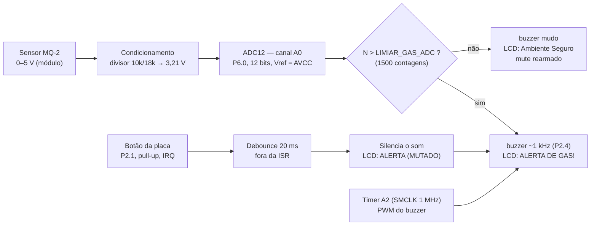

# Engenharia do detector de vazamento de gás

Documento técnico do protótipo: como o sistema é organizado, como os periféricos estão ligados, qual é o
condicionamento de sinal e quais fórmulas governam a decisão de alarme.

> **Como ler este documento.** O projeto tem duas camadas que **não são idênticas**: a *especificação*
> (o que o relatório acadêmico planejou) e a *implementação* (o que o firmware entregue realmente faz).
> As fórmulas e tabelas marcadas como **especificação** vêm de
> [`docs/relatorio.md`](relatorio.md); as marcadas como **implementação** vêm do código em
> [`firmware/include/config.h`](../firmware/include/config.h) e [`firmware/src/`](../firmware/src/).
> Quando os dois divergem — e eles divergem em pontos importantes — a seção
> [§8 Relatório × implementação](#8-relatório--implementação) diz exatamente onde e por quê.

- Texto acadêmico completo: [`docs/relatorio.md`](relatorio.md)
- Lista de materiais e custos: [`hardware/lista-de-materiais.md`](../hardware/lista-de-materiais.md)
- Diagrama de ligação: [`hardware/diagrama.svg`](../hardware/diagrama.svg)
- Bugs e melhorias: [`docs/BUGS_E_MELHORIAS.md`](BUGS_E_MELHORIAS.md)

---

## 1. Visão geral

O sistema é um monitor de gás residencial baseado na **LaunchPad MSP430F5529LP**. O sensor **MQ-2** entrega
uma tensão analógica proporcional à concentração de gás inflamável no ambiente. O MSP430 lê essa tensão pelo
**ADC12**, compara o resultado com um **limiar de disparo** e, se o limiar for ultrapassado, aciona o alerta:
**buzzer** (sonoro) e **mensagem no LCD 16x2**. O usuário pode silenciar o som pelo **botão da placa**, e o
alarme se **rearma automaticamente** quando o nível volta a ficar seguro.

| Característica | Especificação (relatório) | Implementação (firmware) |
| --- | --- | --- |
| Microcontrolador | MSP430F5529 (LaunchPad MSP430F5529LP) | idem |
| Sensor | MQ-2, saída analógica | idem |
| Conversor | ADC12, canal A0 (P6.0), 12 bits | idem |
| Referência do ADC | VCC = 3,3 V | VR+ = AVCC / VR− = AVSS |
| Limiar de alerta | 2048 contagens ≈ 1,65 V (teórico) | **1500 contagens** (calibrado na bancada) |
| Comparação | `N ≥ N_limite` (≥) | `N > LIMIAR_GAS_ADC` (**estritamente maior**) |
| Média de amostras | média de k amostras antes de decidir | **não implementada** (leitura única) |
| Período de amostragem | 100 ms, por timer (CCR0 = 12499) | laço com `__delay_cycles` de ≈ 2 s |
| Tom do buzzer | 2 kHz (CCR0 = 499, CCR1 = 250) | ≈ **1 kHz** (TA2CCR0 = 999, CCR1 = 500) |
| Debounce do botão | 20 ms (2500 ciclos a 125 kHz) | 20 ms (**20000 ciclos** a 1 MHz) |
| Mensagem no LCD | `GAS: 75% LIM` + `STATUS NORMAL` | `Nivel Gas: NNNN` + `Ambiente Seguro` / `ALERTA DE GAS!` |
| Alerta visual | LED1 (P1.0) aceso no alarme | **LED1 (P1.0) acionado pelo firmware** — aceso acima do limiar, inclusive com o buzzer silenciado |
| Faixa de custo | R$ 205,40 a R$ 235,40 | idem |

## 2. Arquitetura do sistema

### 2.1 Diagrama de blocos

```text
                              +------------------------------------------+
                              |      LaunchPad MSP430F5529LP             |
                              |                                          |
   +----------------+  0–3,3 V|  +--------+                              |
   |  Sensor MQ-2   |--------->|  A0 /  |   ADC12     +----------------+ |
   |  (saída anal.) |          |  P6.0  |------------>| decisão:       | |
   +----------------+          +--------+             | N > limiar ?   | |
          ^                                           +-------+--------+ |
          |                                                   |          |
      +3V3 / 5V                                    +----------+----+     |
      (ver §4)                                     |               |     |
                                                   v               v     |
   +----------------+                    +----------------+  +----------------+
   |  Botão (S2/S1) |--- P2.1 ---------->|  GPIO + IRQ    |  |  PWM / GPIO    |
   |  (pull-up int.)|   (P2IV = 0x04)    |  debounce 20ms |  |  P2.4 (TimerA2)|
   +----------------+                    +----------------+  +--------+-------+
                                                                       |
   +----------------+  P3.0 / SDA                                 +-----v------+
   |  LCD 16x2 I2C  |<---------------- P3.1 / SCL --------------->|  Buzzer    |
   +----------------+                                             |  (+ NPN)   |
                                                                  +------------+
   +----------------+  P1.0
   |  LED1 da placa |<---------------- GPIO (aceso enquanto houver risco)
   +----------------+
```

### 2.2 Diagrama em Mermaid



### 2.3 Fluxo de execução (laço principal, como está no firmware)

```text
main()
  │
  ├─ desliga o watchdog (WDTCTL = WDTPW | WDTHOLD)
  ├─ adc_inicia() · buzzer_inicia() · botao_inicia() · i2c_inicia()
  ├─ __enable_interrupt()
  ├─ lcd_inicia()
  └─ for (;;)
       ├─ nivel = adc_le_valor()                  // leitura única do ADC12 (A0)
       ├─ decisao = app_avalia(&estado, nivel)    // regra de decisão pura
       ├─ formata_linha_gas(nivel, linha1)        // "Nivel Gas: NNNN"
       ├─ buzzer_tom(decisao.tom_buzzer)          // TA2CCR1 = 500 (soa) | 1000 (mudo)
       ├─ lcd_escreve_linha(0, linha1)
       ├─ lcd_escreve_linha(1, decisao.mensagem_lcd)
       ├─ if (botao_pressao_confirmada()) app_mutar(&estado)
       └─ __delay_cycles(APP_CICLOS_ENTRE_LEITURAS)   // ≈ 2 s @ 1 MHz
```

A ISR do botão é **curta**: ela apenas sinaliza o evento (`botao_evento = 1`). O debounce de 20 ms é feito
no contexto do laço principal, e não dentro da interrupção.

## 3. Pinagem

### 3.1 Conexões conforme o relatório (Tabela 3.2 do documento acadêmico)

| Sinal | Pino sugerido no MSP430 | Observação |
| --- | --- | --- |
| Saída analógica do sensor MQ-2 | **P6.0 / A0** | Entrada do ADC12 |
| LED1 da LaunchPad | **P1.0** | Saída digital já ligada ao LED da placa |
| Buzzer | **P2.0 / TA1.1** | Saída digital ou PWM via transistor de acionamento |
| Botão S2 da LaunchPad | **P1.1** | Entrada digital com pull-up interno e interrupção de porta |
| LCD 16x2 | **P3.0 / SDA** e **P3.1 / SCL** | Interface I2C, pull-ups em 3,3 V |
| GND do sensor e periféricos | **GND** | Referência comum obrigatória |

### 3.2 Conexões implementadas no firmware

| Sinal | Pino / recurso | Macro em `config.h` | Observação |
| --- | --- | --- | --- |
| Saída analógica do MQ-2 | **P6.0 / A0** | `PORTA_ADC`, `PINO_ADC_BIT_NUM`, `ADC_SEL_REG` | ADC12, canal A0, 12 bits |
| Buzzer | **P2.4** — saída do **Timer A2** | `PORTA_BUZZER`, `PINO_BUZZER_BIT_NUM`, `BUZZER_PIN_BIT`, `BUZZER_TA_CFG` | PWM com `TA2CCR0`/`TA2CCR1` (`TA2CCTL1`, canal 1) |
| Botão de silenciamento | **P2.1** (IRQ de porta) | `PORTA_BOTAO`, `PINO_BOTAO_BIT_NUM`, `BOTAO_P2IV_VALOR = 0x04` | Pull-up interno, borda de descida, ISR curta |
| LCD 16x2 | **P3.0 / SDA** e **P3.1 / SCL** | `PORTA_I2C`, `PINO_I2C_SDA_BIT_NUM`, `PINO_I2C_SCL_BIT_NUM`, `I2C_SEL_BITS` | UCB0 em modo I2C, mestre; endereço do PCF8574 = `0x27` |
| LED1 | **P1.0** | `PORTA_LED`, `PINO_LED_BIT_NUM`, `LED_DIR_REG`, `LED_OUT_REG`, `LED_PIN_BIT` | Saída digital; acionada por `decisao.led_alarme` e coberta pelos testes do simulador |

### 3.3 Por que os pinos mudaram (e como voltar atrás)

O firmware segue a **implementação real**, não a proposta do relatório, por um motivo simples: é o hardware
que foi efetivamente montado e que funcionou na bancada. O botão usado está fisicamente em **P2.1**, e o
buzzer está em **P2.4**, na saída do Timer A2.

Todos os pinos, limiares e tempos estão centralizados em
[`firmware/include/config.h`](../firmware/include/config.h). Para voltar à pinagem do relatório
(P2.0/TA1.1 para o buzzer e P1.1 para o botão), basta alterar as macros desse arquivo — a lógica de decisão
(`app.c`) e os drivers não contêm nenhum número mágico de hardware.

## 4. Condicionamento de sinal

O MSP430F5529 opera em **3,3 V**, e o pino de entrada analógica **não pode receber tensão acima desse valor**.
O módulo do MQ-2, quando alimentado em 5 V, pode apresentar saída acima de 3,3 V — é preciso condicionar o sinal.

### 4.1 Divisor resistivo

Com resistor superior de **10 kΩ** e resistor inferior de **18 kΩ**, uma saída máxima de 5 V é reduzida para:

$$V_{ADC} = 5{,}0 \times \frac{18}{10 + 18} = 3{,}21\ \text{V}$$

Esse valor fica **abaixo de 3,3 V** e ainda aproveita quase toda a faixa do ADC (3,21 V de 3,3 V ≈ 97% da
escala), sem exceder a tensão máxima recomendada para o pino.

| Item | Valor |
| --- | --- |
| R superior (série) | 10 kΩ |
| R inferior (para GND) | 18 kΩ |
| Tensão de entrada máxima | 5,0 V |
| Tensão na entrada do ADC | 3,21 V |
| Corrente no divisor (a 5 V) | ≈ 0,18 mA |

> **Atenção à ordem dos resistores.** Na fórmula, o **18 kΩ é o resistor para o GND**. Se o módulo do sensor
> já for alimentado em 3,3 V e a saída nunca passar de 3,3 V, o divisor pode ser omitido e a saída ligada
> diretamente ao P6.0.

### 4.2 Outros cuidados

- **Pull-ups do I²C**: ligados a **3,3 V**, nunca a 5 V, para proteger P3.0/P3.1.
- **Buzzer**: acionado por **transistor NPN** (com resistor de base de 1 kΩ) quando a corrente necessária for
  maior do que a corrente segura de saída do pino. O pino controla a base; o buzzer fica entre VCC e o coletor.
- **Referência comum**: o GND do sensor, do LCD e da placa precisa ser o mesmo.
- **Trava de barramento**: o driver I²C tem um contador de timeout (`I2C_TIMEOUT_CICLOS`) para não prender o
  firmware caso o barramento fique preso em nível baixo.

## 5. Fórmulas do sistema

> Esta seção apresenta a **especificação** do relatório (o que foi planejado) e, ao lado, o **valor
> implementado**. Serve como ponte entre o documento acadêmico e o código.

### 5.1 Conversão do ADC (especificação)

$$N_{ADC} = \frac{V_{ADC}}{V_{REF}} \times 4095 \qquad \text{(12 bits, } V_{REF} = 3{,}3\ \text{V)}$$

Resolução efetiva por contagem:

$$\Delta V = \frac{3{,}3}{4095} = 0{,}000805\ \text{V} \approx 0{,}805\ \text{mV}$$

Limiar digital correspondente a 1,65 V (valor teórico do relatório):

$$N_{limite} = \frac{1{,}65}{3{,}3} \times 4095 \approx 2048$$

No firmware, o valor **efetivamente usado** é `LIMIAR_GAS_ADC = 1500`, obtido em bancada. O valor teórico
(2048 ≈ 1,65 V) fica preservado em `config.h` como `LIMIAR_GAS_TEORICO_ADC`, justamente para que a
divergência seja explícita e rastreável.

### 5.2 Média de amostras e percentual (especificação)

O relatório planejou decidir pela média de várias amostras e exibir um percentual em relação ao limiar:

$$N_{medio} = \frac{N_1 + N_2 + \cdots + N_k}{k} \qquad\qquad P_{gas} = \frac{N_{medio}}{N_{limite}} \times 100$$

| $N_{medio}$ (limiar 2048) | $P_{gas}$ | Mensagem planejada |
| --- | --- | --- |
| 1536 | 75% | “GAS: 75% LIM” / “STATUS NORMAL” |
| 2007 | 98% | “GAS: 98% LIM” / “PROXIMO LIMITE” |
| 2560 | 125% | “GAS:125% LIM” / “VAZAMENTO?” |

**Na implementação atual** não há média (a leitura é única) e o LCD mostra o **valor bruto do ADC**, não o
percentual:

| Situação | Linha 1 | Linha 2 |
| --- | --- | --- |
| `nivel ≤ 1500` | `Nivel Gas: NNNN` | `Ambiente Seguro` |
| `nivel > 1500`, alarme ativo | `Nivel Gas: NNNN` | `ALERTA DE GAS!` |
| `nivel > 1500`, som silenciado | `Nivel Gas: NNNN` | `ALERTA (MUTADO)` |

A média de amostras e o percentual permanecem como **melhoria planejada** — ver
[`docs/BUGS_E_MELHORIAS.md`](BUGS_E_MELHORIAS.md).

### 5.3 Temporização

**Especificação (relatório).** Com SMCLK em 1 MHz e divisor 8, e amostragem a cada 100 ms:

$$f_{timer} = \frac{1\ \text{MHz}}{8} = 125\ \text{kHz} \qquad T_{tick} = \frac{1}{125000} = 8\ \mu\text{s} \qquad CCR0 = \frac{100\ \text{ms}}{8\ \mu\text{s}} - 1 = 12499$$

**Implementação.** O Timer A2 é usado para o **PWM do buzzer**, não para cadência de amostragem. A cadência
vem de `__delay_cycles(APP_CICLOS_ENTRE_LEITURAS)`, com 2 000 000 ciclos ≈ **2 s** a 1 MHz. Migrar a
cadência para o timer (100 ms, `CCR0 = 12499`) está na lista de melhorias.

**Debounce do botão.** Especificação: 20 ms × 125 kHz = **2500 ciclos**. Implementação: 20 ms a 1 MHz =
**20000 ciclos** (`BOTAO_CICLOS_DEBOUNCE = BOTAO_DEBOUNCE_MS × 1000`).

**Buzzer.** Especificação: 2 kHz com `CCR0 = 1 MHz/2000 − 1 = 499` e `CCR1 = 250`. Implementação:
`BUZZER_PERIODO_CCR0 = 1000` → `TA2CCR0 = 999`, ou seja, período de 1000 contagens a 1 MHz ≈ **1 kHz**,
com `TA2CCR1 = 500` (50% de ciclo de trabalho) para soar e `TA2CCR1 = 1000` (≥ período → saída sempre alta)
para ficar em silêncio.

### 5.4 Resumo dos parâmetros

| Parâmetro | Especificação | Implementação |
| --- | --- | --- |
| Resolução do ADC | 3,3 / 4095 = 0,805 mV/contagem | idem (12 bits, AVCC) |
| Limiar de alerta | 2048 (≈1,65 V) | **1500** |
| Frequência do timer (amostragem) | 125 kHz (SMCLK/8) | não usado para amostragem |
| Período de amostragem | 100 ms (CCR0 = 12499) | ≈ 2 s (`__delay_cycles`) |
| Debounce do botão | 2500 ciclos (125 kHz) | **20000 ciclos** (1 MHz) |
| Tom do buzzer | 2 kHz (CCR0 = 499, CCR1 = 250) | ≈ 1 kHz (TA2CCR0 = 999, CCR1 = 500) |
| Tensão condicionada | 5 × 18/(10+18) = 3,21 V | idem |

## 6. Decisão de alarme (como está implementada)

1. `adc_le_valor()` dispara uma conversão no canal A0, espera a flag `ADC12IFG` e devolve `ADC12MEM0`
   como `uint16_t`.
2. `app_avalia()` compara com `LIMIAR_GAS_ADC` usando **estritamente maior** (`nivel > limiar`): exatamente
   1500 ainda é considerado seguro — mesmo comportamento do protótipo original.
3. Acima do limiar e sem mute: buzzer com `TA2CCR1 = 500` e LCD na linha 2 com `ALERTA DE GAS!`.
4. Acima do limiar e com mute: buzzer em `TA2CCR1 = 1000` (mudo) e LCD com `ALERTA (MUTADO)`.
5. Abaixo ou igual ao limiar: buzzer mudo, LCD com `Ambiente Seguro` e **rearme automático do mute**.

A decisão vive em um módulo **puro** (`app.c`), sem acesso a registradores. Isso permite rodar exatamente a
mesma regra de negócio no PC, em `firmware/sim/`, com casos de teste para abaixo/no limiar/acima, mute,
rearme e formatação das 16 colunas.

## 7. Módulos do firmware

| Caminho | Papel |
| --- | --- |
| `firmware/include/config.h` | **Ponto único** de pinos, limiares, endereços e tempos |
| `firmware/src/adc.c` | ADC12: configuração, `ADC12ENC`, espera da referência e leitura |
| `firmware/src/i2c.c` | Camada I²C (mestre, polling, tratamento de NACK e timeout) |
| `firmware/src/lcd.c` | Driver do LCD 16x2 em modo 4 bits via PCF8574 |
| `firmware/src/buzzer.c` | Timer A2 em PWM no pino P2.4 |
| `firmware/src/botao.c` | Interrupção de porta (P2.1) + debounce fora da ISR |
| `firmware/src/app.c` | **Lógica de decisão** (pura, testável sem hardware) |
| `firmware/src/texto.c` | Layout de texto do LCD (quebra de linha e preenchimento) |
| `firmware/src/main.c` | Orquestração: inicializa e roda o laço |
| `firmware/sim/` | Simulador e testes da lógica no PC (sem MSP430) |

## 8. Relatório × implementação

Esta é a parte que costuma faltar em projeto de portfólio: a lista **explícita** do que o documento
acadêmico promete e o que o código entrega.

### 8.1 Divergências de pinagem

| Sinal | Proposta no relatório | Implementação real | Situação |
| --- | --- | --- | --- |
| Saída analógica do MQ-2 | P6.0 / A0 | **P6.0 / A0** | Mantido |
| LCD 16x2 | P3.0 / SDA, P3.1 / SCL | **P3.0 / SDA, P3.1 / SCL** | Mantido |
| Buzzer | P2.0 / TA1.1 | **P2.4** (saída do Timer A2) | Alterado — a montagem usou P2.4 |
| Botão de silenciamento | P1.1 (rotulado S2) | **P2.1** (`P2IV = 0x04`) | Alterado — é o botão disponível na placa |
| LED1 | P1.0 | **P1.0** (`LED_DIR_REG`/`LED_OUT_REG`) | Implementado no firmware organizado (não existia no sketch original) |

> **Nota técnica sobre o canal do timer.** No MSP430F5529, o pino **P2.4** corresponde à saída **TA2.1**
> (canal 1 do Timer A2) — e é exatamente esse canal que o código configura (`TA2CCTL1`/`TA2CCR1`). O
> comentário do código original dizia “P2.5 / TA2.2”, o que não correspondia ao pino configurado; o
> comentário foi corrigido no firmware atual. Ao citar a pinagem do buzzer em outros documentos, o dado que
> importa para a montagem é o **pino P2.4**.
>
> **Nota sobre o rótulo do botão (S1 × S2).** O sketch original chama o botão de **S1** (por isso o
> identificador `ISR_Botao_S1`, mantido no código preservado), e o relatório chama o mesmo botão de **S2**.
> A LaunchPad MSP-EXP430F5529LP tem dois botões de usuário, em **P1.1** e **P2.1**, e a serigrafia que
> associa cada um a "S1"/"S2" varia com a revisão da placa (conferir o user's guide SLAU533). Por isso
> **a documentação deste repositório se refere ao botão pelo pino** — "botão em P2.1" — sempre que a
> precisão importa, e o firmware organizado nomeia a interrupção de `ISR_Botao_Mute`, sem depender do
> rótulo da placa. O que importa para remontar é `P2.1` com `P2IV == 0x04`.

### 8.2 Divergências de comportamento

| Item | Relatório | Firmware | Impacto |
| --- | --- | --- | --- |
| Limiar | 2048 (1,65 V) | 1500 (bancada) | Limiar mais sensível, ajustado ao sensor real |
| Comparação | `≥` | `>` (estritamente maior) | Exatamente no limiar continua seguro |
| Cadência | 100 ms por timer | ≈ 2 s por `__delay_cycles` | Detecção mais lenta que o planejado |
| Média de amostras | prevista | ausente | Mais suscetível a ruído e picos |
| LCD | percentual do limiar | valor bruto do ADC (0–4095) | Menos interpretável, mas honesto |
| Mensagens | `VAZAMENTO?`, `SOM SILENCIADO` | `ALERTA DE GAS!`, `ALERTA (MUTADO)` | Textos diferentes, mesma semântica |
| Tom do buzzer | 2 kHz | ≈ 1 kHz | Ainda audível; menos agudo |
| LED | aceso no alarme | **aceso no alarme** (implementado no firmware organizado) | Redundância visual fechada; permanece aceso mesmo silenciado |
| Silenciamento | janela temporizada | persistente até o nível cair (rearme) | O som não volta sozinho com o gás alto |

### 8.3 Por que o firmware default segue a implementação real

O firmware é gravado na placa física: os pinos **precisam** corresponder ao hardware montado. Se ele usasse
P2.0/TA1.1 para o buzzer e P1.1 para o botão, o buzzer não soaria e o botão não responderia. Além disso, a
lógica de comportamento foi mantida **idêntica à do protótipo que funcionou na bancada** — as correções
atacaram bugs e legibilidade, não a regra de decisão.

Para trocar pinos, limiares e tempos, edite `firmware/include/config.h` e recompile. Nada disso está
espalhado pelo código.

## 9. Calibração na bancada

1. Alimentar o MQ-2 e aguardar o **pré-aquecimento** (o elemento sensor aquece e a leitura cai até estabilizar).
2. Registrar `N_ar` com o sensor em **ar limpo e ventilado**.
3. Registrar `N_gas` com o sensor exposto a uma **pequena concentração controlada** de gás (sempre em ambiente
   ventilado e com supervisão).
4. Definir o limiar entre os dois valores. No protótipo, o valor prático adotado foi **1500** — abaixo do
   limiar teórico de 2048, o que torna o alarme mais sensível ao sensor real usado.
5. Gravar o valor em `LIMIAR_GAS_ADC` no `firmware/include/config.h` e recompilar.

## 10. Documentos relacionados

| Documento | Conteúdo |
| --- | --- |
| [`docs/relatorio.md`](relatorio.md) | Relatório acadêmico completo (caps. 1–3) |
| [`docs/pesquisa.md`](pesquisa.md) | Pesquisa de campo e requisitos |
| [`docs/BUGS_E_MELHORIAS.md`](BUGS_E_MELHORIAS.md) | Bugs do código original e trabalho futuro |
| [`hardware/diagrama.svg`](../hardware/diagrama.svg) | Diagrama de ligação desenhado em SVG |
| [`hardware/lista-de-materiais.md`](../hardware/lista-de-materiais.md) | BOM com custos |
| [`report/relatorio.pdf`](../report/relatorio.pdf) | Relatório recompilado em LaTeX |
