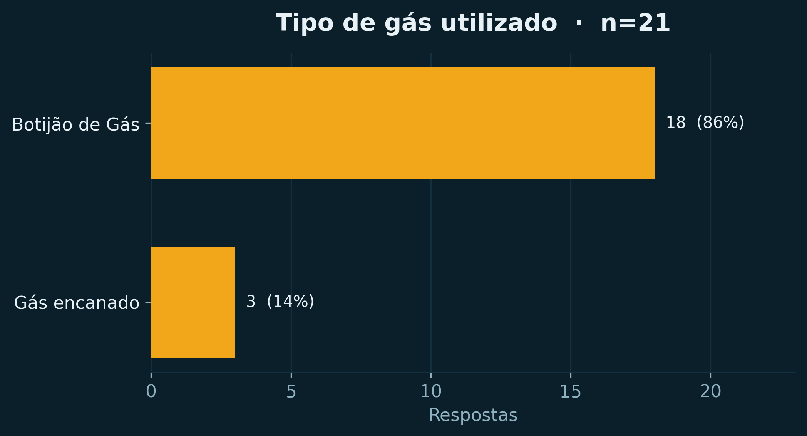
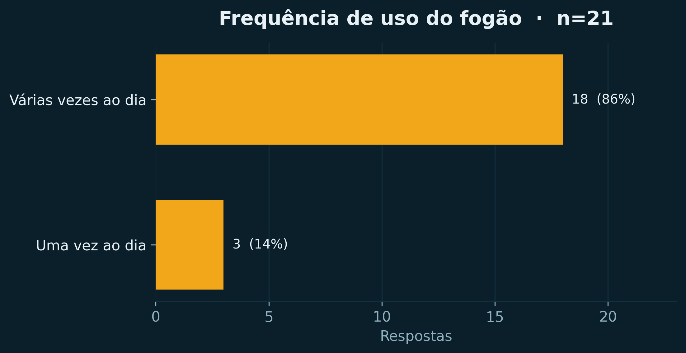
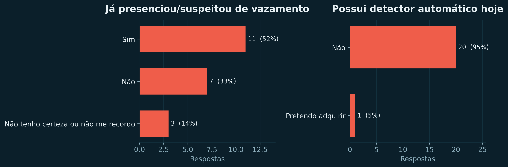
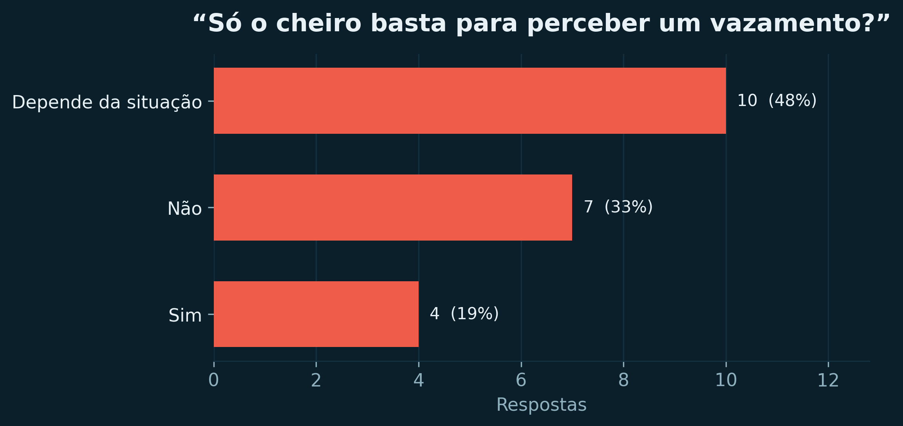
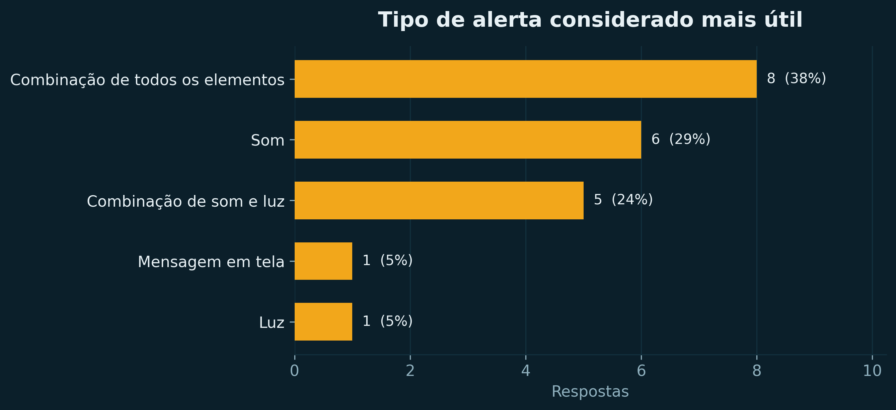
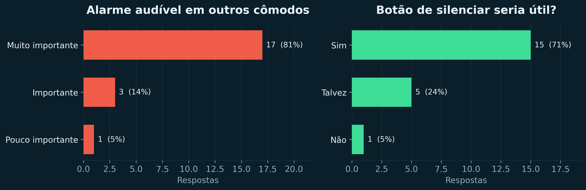
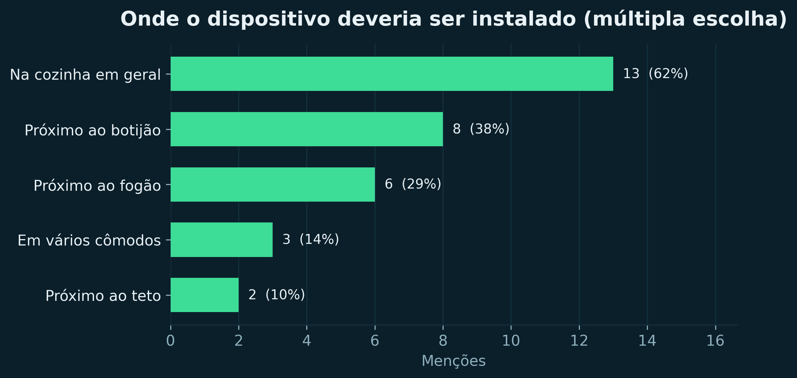

# Pesquisa de campo — entender o problema antes de projetar

Todo projeto embarcado começa com uma pergunta simples: **quem tem o problema e como ele aparece no dia a dia?**
Neste projeto, a resposta veio de uma conversa de condomínio — e depois foi confirmada por um formulário
digital com 21 respostas. Este documento conta essa história e mostra, número por número, como cada
resultado virou um requisito de projeto.

> **Resumo em uma frase.** Quase todo mundo usa gás todos os dias, quase ninguém tem detecção automática
> e a única forma de detecção citada por **100%** das pessoas é o olfato — justamente o sentido que falha
> em idosos, pessoas com limitações sensoriais ou em momentos de distração.

| Ficha da pesquisa | |
| --- | --- |
| **Método** | Entrevistas presenciais + formulário digital |
| **Plataforma** | Tally Forms |
| **Período de coleta** | 2026-05-10 a 2026-05-11 |
| **Respostas** | **21** |
| **Perguntas** | 12 |
| **Público** | Moradores do condomínio do pesquisador e pessoas próximas |
| **Amostra** | De conveniência (não probabilística) |
| **Dados brutos** | [`data/survey.json`](../data/survey.json) |
| **Relatório completo de análise** | [`analysis/out/analise.md`](../analysis/out/analise.md) |
| **Script de análise** | [`analysis/analisar_pesquisa.py`](../analysis/analisar_pesquisa.py) |

---

## 1. O relato que originou tudo

Durante as conversas com moradores do condomínio, **uma moradora relatou dificuldade para perceber o cheiro de gás**.
Houve um vazamento no fogão de sua residência que permaneceu sem ser identificado durante um período — e só foi
percebido quando o responsável pela troca do botijão entrou no ambiente, sentiu o cheiro forte e alertou sobre o
vazamento.

O que chama atenção no relato não é o vazamento em si, mas o **mecanismo de descoberta**: ele não veio de um
sistema de segurança, veio de um terceiro que, por acaso, tinha o olfato funcionando naquele dia. Se a troca do
botijão tivesse acontecido depois, a exposição teria continuado.

Esse caso isolado levantou uma hipótese que a pesquisa depois confirmou: a identificação de vazamentos depende
fortemente da percepção humana, especialmente do olfato, e falha exatamente nos cenários de maior risco —
idosos, pessoas com limitações sensoriais, moradores distraídos ou que passam grande parte do tempo sozinhos.

## 2. Método

1. **Entrevistas curtas e conversas informais** com moradores do condomínio, cobrindo situações de risco doméstico,
   acidentes dentro de casa, percepção de perigo, vulnerabilidade de idosos e utilidade de alertas automáticos.
2. **Formulário digital (Tally)** com 12 perguntas, compartilhado com o condomínio e com pessoas externas à
   comunidade inicial, para ampliar a amostra e quantificar os padrões vistos nas conversas.
3. **Análise descritiva** dos resultados (contagens e percentuais), com cruzamento entre perfil de uso, experiência
   prévia e preferências de alerta.
4. **Tradução em requisitos**: cada resultado relevante foi convertido em uma decisão de projeto (seção 5).

### As 12 perguntas do formulário

| # | Pergunta | Tipo de resposta |
| --- | --- | --- |
| 1 | Você utiliza botijão de gás ou gás encanado? | Escolha única |
| 2 | Qual é a sua idade? | Número |
| 3 | Com que frequência você utiliza o fogão a gás? | Escolha única |
| 4 | Você já presenciou ou suspeitou de algum vazamento de gás? | Escolha única |
| 5 | Como você identificaria um possível vazamento de gás? | Múltipla escolha |
| 6 | Você possui algum detector ou sistema automático de alerta de gás? | Escolha única |
| 7 | Você considera que apenas o cheiro do gás é suficiente para perceber um vazamento? | Escolha única |
| 8 | Em uma situação de vazamento, qual tipo de alerta seria mais útil? | Escolha única |
| 9 | Você acha muito importante que o alarme seja alto o suficiente para ser ouvido em outros cômodos? | Escala |
| 10 | Um botão para silenciar temporariamente o alarme seria útil? | Escolha única |
| 11 | Onde você acha que um dispositivo de alerta de gás deveria ser instalado? | Múltipla escolha |
| 12 | Quais características seriam mais importantes em um sistema desse tipo? | Múltipla escolha |

> As perguntas 5, 11 e 12 são de múltipla escolha: a soma das menções pode passar de 21.

---

## 3. Resultados

### 3.1 Perfil de uso: gás é rotina diária

O retrato é claro: **86% (18 de 21) usam botijão de gás** e **86% (18 de 21) acendem o fogão várias vezes ao dia**.
Não se trata de um risco esporádico — é uma exposição cotidiana e repetida.

*Gráfico 1 — Tipo de gás utilizado (`analysis/out/figura-01-tipo-de-gas.png`).*

| Tipo de gás | N | % |
| --- | --- | --- |
| Botijão de gás | 18 | 85,7% |
| Gás encanado | 3 | 14,3% |

*Gráfico 2 — Frequência de uso do fogão (`analysis/out/figura-02-frequencia-de-uso.png`).*

| Frequência de uso | N | % |
| --- | --- | --- |
| Várias vezes ao dia | 18 | 85,7% |
| Uma vez ao dia | 3 | 14,3% |

**Idade:** 18 respondentes informaram a idade (as 4 primeiras respostas foram registradas antes de o campo
de idade entrar no formulário). Média de **23,6 anos**, mediana de **21**, faixa de **19 a 54 anos**.

> **Leitura de engenharia.** O predomínio de botijão importa para o projeto: o botijão é um ponto de
> vazamento concentrado, fica em local conhecido e é justamente onde a pesquisa aponta que o dispositivo
> deveria estar. O predomínio de uso “várias vezes ao dia” significa que o sistema precisa conviver com o
> ambiente da cozinha 24 horas por dia sem incomodar — reforçando a necessidade de um botão de silenciamento
> e de um limiar bem calibrado, para não disparar a cada fritura.

### 3.2 Experiência com vazamentos: o risco já esteve presente

**52% (11 de 21)** já presenciaram ou suspeitaram de um vazamento. Ao mesmo tempo, **95% (20 de 21) não possuem
nenhum detector automático** — e o único participante que respondeu algo diferente disse apenas que *pretende
adquirir*, ou seja, **não há uma única instalação ativa na amostra**.

*Gráfico 3 — Experiência prévia com vazamentos × posse de detector (`analysis/out/figura-03-vazamento-e-detector.png`).*

| Já presenciou ou suspeitou de vazamento? | N | % |
| --- | --- | --- |
| Sim | 11 | 52,4% |
| Não | 7 | 33,3% |
| Não tenho certeza ou não me recordo | 3 | 14,3% |

| Possui detector ou sistema automático? | N | % |
| --- | --- | --- |
| Não | 20 | 95,2% |
| Pretendo adquirir | 1 | 4,8% |

> **Leitura de engenharia.** Metade da amostra já conviveu com a suspeita de um vazamento e praticamente
> ninguém tem proteção automática. Existe demanda latente e um vazio de solução — o protótipo não compete
> com um detector já instalado, ele ocupa um espaço vazio.

### 3.3 Dependência da percepção humana: o ponto crítico

Todos os **21 participantes (100%)** citaram **o cheiro** como forma de identificar um vazamento. Outras formas
aparecem de maneira marginal: mudança na chama do fogão (9,5%), som do vazamento (4,8%) e “outro” (4,8%).

*Gráfico 4 — Formas de identificação de vazamento citadas (`analysis/out/figura-04-formas-de-deteccao.png`).*

| Forma de identificação | Menções | % |
| --- | --- | --- |
| Pelo cheiro | 21 | 100,0% |
| Mudança na chama do fogão | 2 | 9,5% |
| Pelo som do vazamento | 1 | 4,8% |
| Outro | 1 | 4,8% |

E o próprio público reconhece a fragilidade desse método: **81% (17 de 21)** responderam que o cheiro **não basta**
(depende da situação: 47,6%; não: 33,3%), enquanto apenas 19% (4 de 21) consideram o cheiro suficiente em
qualquer situação.

*Gráfico 5 — “Apenas o cheiro é suficiente?” (`analysis/out/figura-05-cheiro-suficiente.png`).*

| Apenas o cheiro é suficiente? | N | % |
| --- | --- | --- |
| Depende da situação | 10 | 47,6% |
| Não | 7 | 33,3% |
| Sim | 4 | 19,0% |

> **Leitura de engenharia.** Este é o resultado que justifica o projeto inteiro. A detecção é 100% dependente
> do olfato — e 81% da própria amostra admite que esse método falha em alguma situação. Um alerta eletrônico
> **redundante**, que não depende de atenção nem de olfato, ataca diretamente essa lacuna.

### 3.4 Preferências de alerta: som + luz, e alto o suficiente

Quando perguntados sobre o alerta mais útil, a preferência é por **redundância sensorial**: 38,1% querem
“combinação de todos os elementos” e 23,8% querem “som e luz” — somados, **62% preferem alguma combinação**
de avisos. Som isolado fica com 28,6%, mensagem em tela 4,8% e luz isolada 4,8%.

*Gráfico 6 — Tipo de alerta considerado mais útil (`analysis/out/figura-06-tipo-de-alerta.png`).*

| Tipo de alerta mais útil | N | % |
| --- | --- | --- |
| Combinação de todos os elementos | 8 | 38,1% |
| Som | 6 | 28,6% |
| Combinação de som e luz | 5 | 23,8% |
| Mensagem em tela | 1 | 4,8% |
| Luz | 1 | 4,8% |

O volume também importa: **95% (20 de 21)** consideram importante ou muito importante que o alarme seja ouvido
em outros cômodos (muito importante: 81%). E **71% (15 de 21)** acham que um **botão de silenciamento** seria útil
(23,8% responderam “talvez”, 4,8% “não”).

*Gráfico 7 — Ouvir em outros cômodos × utilidade do botão (`analysis/out/figura-07-alerta-e-silenciamento.png`).*

| O alarme precisa ser ouvido em outros cômodos? | N | % |
| --- | --- | --- |
| Muito importante | 17 | 81,0% |
| Importante | 3 | 14,3% |
| Pouco importante | 1 | 4,8% |

| Um botão de silenciar seria útil? | N | % |
| --- | --- | --- |
| Sim | 15 | 71,4% |
| Talvez | 5 | 23,8% |
| Não | 1 | 4,8% |

> **Leitura de engenharia.** A combinação **som + LED + texto no LCD** não é um capricho de projeto: é a
> resposta direta à preferência de 62% dos participantes. O botão de silenciamento, pedido por 71%, evita que
> o alarme vire um incômodo — e o requisito de “ouvir em outros cômodos” define um buzzer audível, não um
> sinal fraco preso à bancada.

### 3.5 Onde instalar e o que mais valorizam

Os locais mais citados foram **a cozinha em geral (61,9%)**, **próximo ao botijão (38,1%)** e **próximo ao
fogão (28,6%)**. A média é de **1,5 locais por participante** — ou seja, o público enxerga a solução como algo
que pode estar em mais de um ponto da casa.

*Gráfico 8 — Locais sugeridos para instalação (`analysis/out/figura-08-locais-de-instalacao.png`).*

| Local sugerido | Menções | % |
| --- | --- | --- |
| Na cozinha em geral | 13 | 61,9% |
| Próximo ao botijão | 8 | 38,1% |
| Próximo ao fogão | 6 | 28,6% |
| Em vários cômodos | 3 | 14,3% |
| Próximo ao teto | 2 | 9,5% |

Entre as características valorizadas, lideram **facilidade de instalação (17 menções)**, **aviso sonoro (15)**,
**baixo custo (12)** e **integração com celular (12)**. Na sequência: simplicidade (10), tamanho reduzido (10),
baixo consumo de energia (10) e aviso visual (7).

*Gráfico 9 — Características mais valorizadas (`analysis/out/figura-09-caracteristicas-desejadas.png`).*

| Característica | Menções | % |
| --- | --- | --- |
| Facilidade de instalação | 17 | 81,0% |
| Aviso sonoro | 15 | 71,4% |
| Baixo custo | 12 | 57,1% |
| Integração com celular | 12 | 57,1% |
| Simplicidade | 10 | 47,6% |
| Tamanho reduzido | 10 | 47,6% |
| Baixo consumo de energia | 10 | 47,6% |
| Aviso visual | 7 | 33,3% |

### 3.6 Limitações da amostra

- **Amostra de conveniência** (21 respostas), compartilhada no condomínio do pesquisador e com pessoas
  próximas — **não é uma amostra probabilística** e não deve ser extrapolada para a população brasileira.
- A idade só foi coletada **a partir da 5ª resposta**, por isso a média considera 18 participantes.
- Perguntas de múltipla escolha permitem mais de uma marcação, então a soma das menções pode passar de 21.
- A coleta ocorreu em **2026-05-10 a 2026-05-11**; o perfil etário (predomínio de pessoas jovens, mediana 21)
  difere do público-alvo original (idosos), o que é uma **oportunidade de aprofundamento** em uma próxima rodada.

---

## 4. Resultados → requisitos de projeto

| # | Evidência na pesquisa | Requisito adotado | Onde aparece no projeto |
| --- | --- | --- | --- |
| 1 | 62% preferem combinação de alertas; 95% querem ouvir em outros cômodos | **Alerta redundante**: buzzer + mensagem no LCD (LED1 também previsto) | [`docs/engenharia.md`](engenharia.md), firmware |
| 2 | 71% consideram o botão de silenciar útil | **Botão da placa** silencia o buzzer, mantendo a indicação no LCD ativa | `firmware/src/botao.c` (debounce de 20 ms fora da ISR) |
| 3 | 61,9% citam a cozinha, 38,1% o botijão, 28,6% o fogão | **Instalação simples** próxima ao fogão/botijão, com 1,5 pontos por residência | [`hardware/lista-de-materiais.md`](../hardware/lista-de-materiais.md) |
| 4 | Facilidade de instalação (17), baixo custo (12), simplicidade (10) | **Montagem em protoboard**, componentes de baixo custo, sem módulos extras | BOM: R$ 205,40 a R$ 235,40 |
| 5 | Integração com celular (12 menções) | **Fora do escopo** por custo/complexidade; registrado como trabalho futuro | [`docs/BUGS_E_MELHORIAS.md`](BUGS_E_MELHORIAS.md) |
| 6 | 100% dependem do cheiro; 81% dizem que ele não basta | **Detecção eletrônica** com limiar calibrado e indicação de percentual | [`docs/engenharia.md`](engenharia.md) § ADC |
| 7 | 52% já suspeitaram de vazamento; 95% sem detector | O sistema deve ser **barato o bastante para ser adotado**, não substituir equipamentos certificados | Relatório § 3.5.4 |

---

## 5. Conclusão

A pesquisa começou com o relato de uma moradora que não conseguia sentir o cheiro de gás e terminou com uma
hipótese confirmada por 21 respostas: **a segurança contra vazamentos hoje depende inteiramente do olfato, e
o próprio público sabe que isso não é suficiente.**

O projeto responde com um alerta eletrônico redundante — som, luz e texto — acionado por um limiar calibrado
e com um botão de silenciamento para não transformar segurança em incômodo. Todos os requisitos técnicos
listados na tabela da seção 4 vêm diretamente de um número desta pesquisa; nenhum deles foi definido
“porque sim”.
