# Detector de Vazamento de Gás com MSP430

**Relatório do Projeto Final — Laboratório de Sistemas Microprocessados**

| | |
| --- | --- |
| **Instituição** | Universidade de Brasília — Faculdade de Tecnologia — Departamento de Engenharia Elétrica |
| **Disciplina** | Laboratório de Sistemas Microprocessados |
| **Professor** | José Edil G. de Medeiros |
| **Autores** | Victor Hugo Guimarães Nascimento · Davi Sousa da Vinha |
| **Local / Período** | Brasília · 2026/1 |

> **Sobre este documento.** Este arquivo é a conversão fiel, para Markdown navegável, do relatório
> acadêmico original (23 páginas em PDF). O texto, as seções, as tabelas e as numerações de figuras
> foram preservados; apenas erros claros de digitação foram corrigidos e as equações — que aparecem
> quebradas na extração automática do PDF — foram reconstruídas na notação correta. A versão
> recompilada em LaTeX está em [`report/relatorio.pdf`](../report/relatorio.pdf) e o fonte em
> [`report/relatorio.tex`](../report/relatorio.tex).

---

## Sumário

- [Capítulo 1 — Pesquisa de Campo](#capítulo-1--pesquisa-de-campo)
  - [1.1 Contextualização](#11-contextualização)
  - [1.2 Comunidade pesquisada](#12-comunidade-pesquisada)
  - [1.3 Justificativa da escolha](#13-justificativa-da-escolha)
  - [1.4 Objetivo da pesquisa de campo](#14-objetivo-da-pesquisa-de-campo)
  - [1.5 Método de pesquisa](#15-método-de-pesquisa)
- [Capítulo 2 — Entrevistas e Levantamento de Necessidades](#capítulo-2--entrevistas-e-levantamento-de-necessidades)
  - [2.1 Relato identificado na comunidade](#21-relato-identificado-na-comunidade)
  - [2.2 Ampliação da pesquisa por formulário digital](#22-ampliação-da-pesquisa-por-formulário-digital)
  - [2.3 Resultados obtidos](#23-resultados-obtidos)
  - [2.4 Definição do problema](#24-definição-do-problema)
- [Capítulo 3 — Proposta e Planejamento do Projeto Final](#capítulo-3--proposta-e-planejamento-do-projeto-final)
  - [3.1 Objetivos do trabalho](#31-objetivos-do-trabalho)
  - [3.2 Proposta de solução](#32-proposta-de-solução)
  - [3.3 Lista de materiais e esquemático](#33-lista-de-materiais-e-esquemático)
  - [3.4 Implementação](#34-implementação)
  - [3.5 Resultados e conclusão](#35-resultados-e-conclusão)

---

# Capítulo 1

## Pesquisa de Campo

### 1.1 Contextualização

A pesquisa de campo foi planejada para sondar situações de risco doméstico percebidas por moradores de um ambiente residencial, especialmente idosos, familiares, cuidadores e pessoas responsáveis por atividades domésticas.

Situações de risco doméstico fazem parte do cotidiano de muitas pessoas e podem ocorrer por distração, esquecimento, dificuldade de percepção de sinais de perigo ou ausência de mecanismos automáticos de alerta. Esses problemas podem se tornar mais relevantes em ambientes onde vivem idosos, pessoas com limitações sensoriais ou moradores que passam grande parte do tempo sozinhos.

Entretanto, muitas dessas situações acabam sendo percebidas apenas após acidentes, falhas ou relatos de terceiros, tornando importante investigar quais problemas domésticos afetam mais a comunidade e como os moradores lidam com questões relacionadas à segurança no cotidiano.

### 1.2 Comunidade pesquisada

A comunidade escolhida foi o condomínio onde o pesquisador reside. O público previsto incluiu idosos, moradores que vivem sozinhos, cuidadores, familiares responsáveis por idosos e moradores que já passaram por situações de risco doméstico.

Esse público foi escolhido por estar diretamente relacionado ao contexto investigado e por poder relatar experiências, dificuldades e preocupações relacionadas à segurança em ambientes residenciais.

### 1.3 Justificativa da escolha

A escolha dessa comunidade se justifica pela proximidade com o cotidiano investigado e pela possibilidade de compreender problemas reais enfrentados pelos moradores. Além disso, a presença de idosos e pessoas que vivem sozinhas pode permitir identificar situações em que dificuldades de percepção, distração ou ausência de mecanismos de alerta contribuam para aumentar riscos domésticos.

A pesquisa com essa comunidade permite compreender melhor quais situações são consideradas mais preocupantes pelos moradores e quais necessidades podem existir relacionadas à segurança doméstica.

### 1.4 Objetivo da pesquisa de campo

O objetivo da pesquisa de campo foi investigar como moradores de ambientes residenciais percebem situações de risco doméstico e identificar dificuldades relacionadas à segurança no cotidiano.

Mais especificamente, a pesquisa buscou:

- compreender quais situações domésticas são consideradas mais perigosas pelos moradores;
- investigar se os moradores já passaram por acidentes, falhas ou situações de risco doméstico;
- identificar dificuldades relacionadas à percepção de problemas domésticos;
- compreender como os moradores lidam com situações de risco no dia a dia;
- levantar possíveis necessidades da comunidade que pudessem motivar uma solução embarcada.

### 1.5 Método de pesquisa

Inicialmente, foram previstas entrevistas curtas e conversas informais com moradores do condomínio. As perguntas planejadas abordavam situações de risco doméstico, acidentes dentro de casa, percepção de perigo, maior vulnerabilidade de idosos e utilidade de mecanismos automáticos de alerta.

As respostas seriam analisadas para identificar padrões, preocupações recorrentes e possíveis necessidades relacionadas à segurança doméstica. A expectativa era que os resultados permitissem definir com mais precisão um problema real da comunidade e orientar as próximas etapas do projeto.

---

# Capítulo 2

## Entrevistas e Levantamento de Necessidades

### 2.1 Relato identificado na comunidade

Durante as conversas realizadas com moradores, uma moradora relatou possuir dificuldade para perceber cheiro de gás. Segundo o relato, houve um vazamento no fogão de sua residência que permaneceu sem identificação durante determinado período.

A situação só foi percebida após a troca do botijão, quando o responsável pela instalação identificou forte cheiro de gás no ambiente e alertou sobre a existência do vazamento.

O caso chamou atenção por evidenciar que a identificação de vazamentos pode depender fortemente da percepção humana, especialmente do olfato.

Esse relato indicou uma possível vulnerabilidade em ambientes residenciais, principalmente em situações envolvendo idosos, pessoas com limitações sensoriais, distração ou ausência de pessoas próximas ao local do vazamento.

### 2.2 Ampliação da pesquisa por formulário digital

A partir desse relato, o tema foi aprofundado por meio de um formulário digital na plataforma Tally. O formulário foi compartilhado com moradores do condomínio e também com pessoas externas à comunidade inicial, buscando obter uma visão mais ampla sobre hábitos de segurança, percepção de risco e preferências de alerta em situações relacionadas ao uso de gás de cozinha.

As perguntas utilizadas no formulário foram:

1. Você utiliza botijão de gás ou gás encanado?
2. Qual é a sua idade?
3. Com que frequência você utiliza o fogão a gás?
4. Você já presenciou ou suspeitou de algum vazamento de gás?
5. Como você identificaria um possível vazamento de gás?
6. Você possui algum detector ou sistema automático de alerta de gás?
7. Você considera que apenas o cheiro do gás é suficiente para perceber um vazamento?
8. Em uma situação de vazamento, qual tipo de alerta seria mais útil?
9. Você acha muito importante que o alarme seja alto o suficiente para ser ouvido em outros cômodos?
10. Um botão para silenciar temporariamente o alarme seria útil?
11. Onde você acha que um dispositivo de alerta de gás deveria ser instalado?
12. Quais características seriam mais importantes em um sistema desse tipo?

### 2.3 Resultados obtidos

#### 2.3.1 Perfil de uso do gás

A maioria dos participantes informou utilizar botijão de gás. Além disso, a maior parte afirmou utilizar o fogão a gás várias vezes ao dia, indicando que o tema está relacionado a uma atividade cotidiana e recorrente.

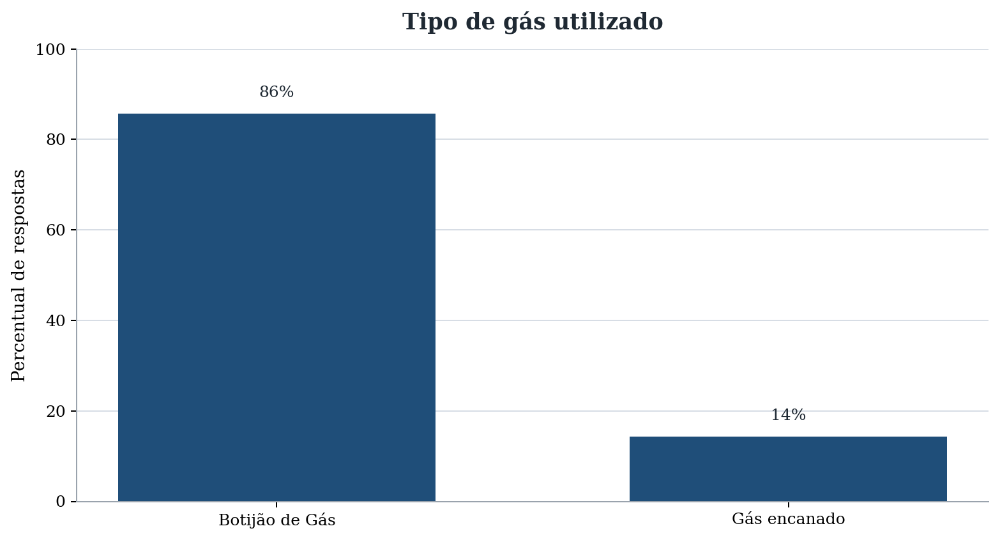

*Figura 2.1: Tipo de gás utilizado pelos participantes.*

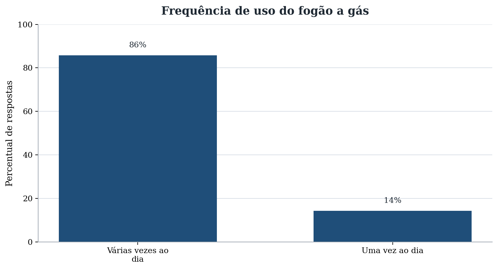

*Figura 2.2: Frequência de uso do fogão a gás.*

#### 2.3.2 Experiência com vazamentos e mecanismos de detecção

Os dados indicam que uma parte significativa dos participantes já presenciou ou suspeitou de algum vazamento de gás. Ao mesmo tempo, quase todos afirmaram não possuir detector ou sistema automático de alerta, o que reforça a dependência de métodos manuais ou sensoriais para identificar situações de risco.

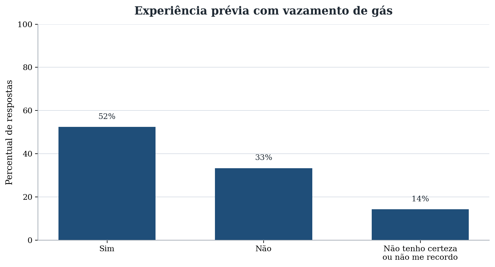

*Figura 2.3: Experiência prévia com suspeita ou vazamento de gás.*

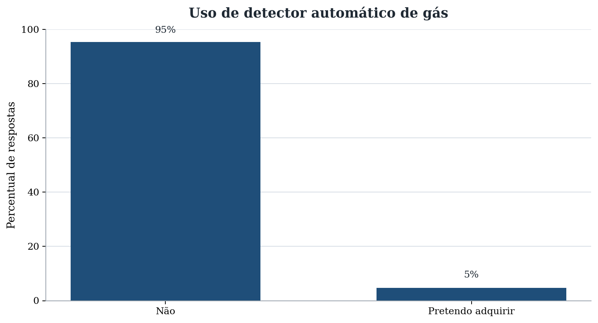

*Figura 2.4: Uso de detector ou sistema automático de alerta.*

#### 2.3.3 Dependência da percepção humana

Todos os participantes indicaram o cheiro como forma de identificar um possível vazamento. Entretanto, nem todos consideram que apenas o cheiro é suficiente em qualquer situação. Esse resultado reforça o problema identificado no relato da moradora, pois mostra que a detecção ainda depende fortemente da percepção humana.

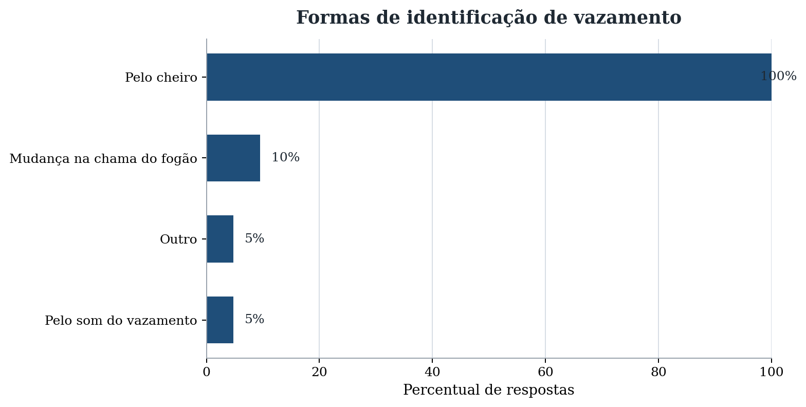

*Figura 2.5: Formas de identificação de possível vazamento.*

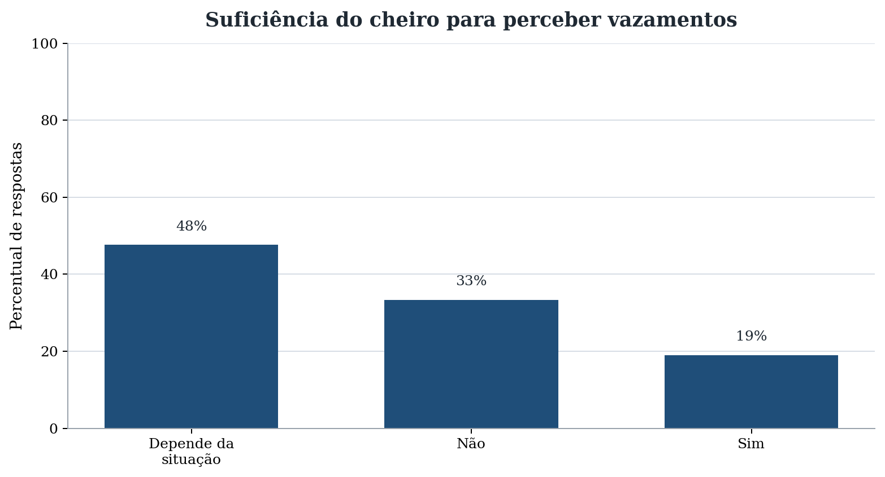

*Figura 2.6: Percepção sobre a suficiência do cheiro para detectar vazamentos.*

#### 2.3.4 Preferências de alerta

As respostas indicaram interesse por alertas sonoros, visuais e combinações de diferentes formas de aviso. A maioria também considerou importante que o alarme seja perceptível em outros cômodos da residência.

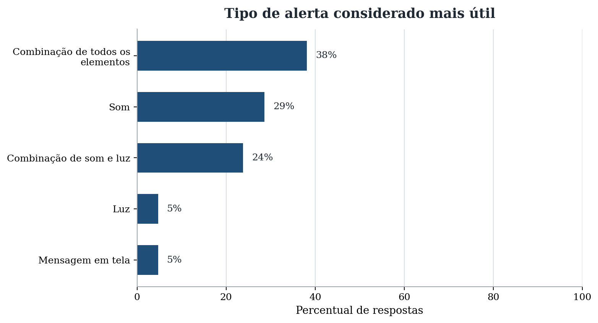

*Figura 2.7: Tipos de alerta considerados mais úteis.*

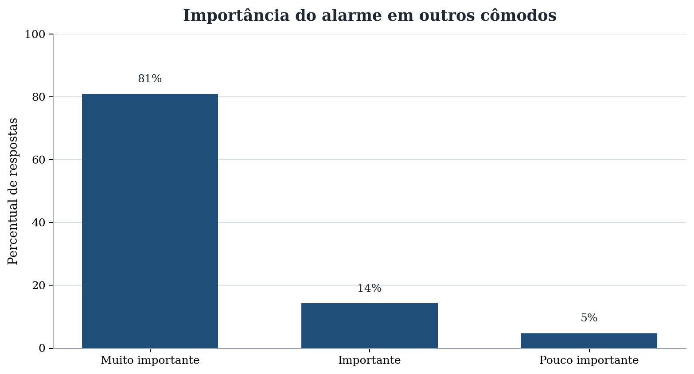

*Figura 2.8: Importância de o alarme ser ouvido em outros cômodos.*

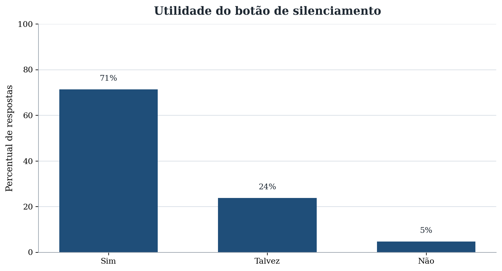

*Figura 2.9: Utilidade de um botão para silenciar temporariamente o alarme.*

#### 2.3.5 Local de instalação e características desejadas

Os participantes indicaram principalmente a cozinha, o botijão e o fogão como locais relevantes para instalação de um dispositivo de alerta. Entre as características mais citadas, destacaram-se facilidade de instalação, aviso sonoro, baixo custo e possibilidade de integração com celular.

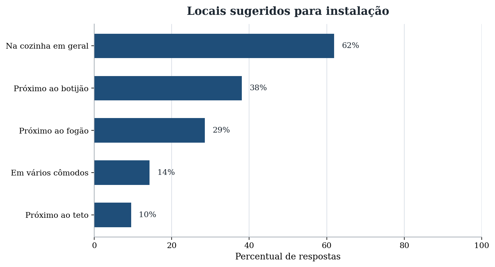

*Figura 2.10: Locais sugeridos para instalação do dispositivo.*

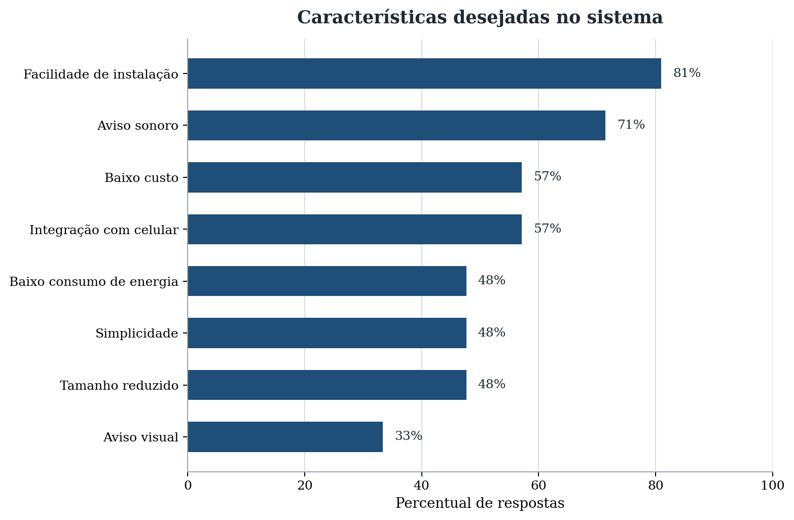

*Figura 2.11: Características mais valorizadas em uma solução.*

### 2.4 Definição do problema

Com base nas entrevistas e nos resultados do formulário digital, definiu-se como problema principal a dificuldade de identificação rápida de vazamentos de gás em ambientes residenciais.

O problema se torna mais relevante em situações nas quais o morador depende apenas do cheiro para perceber o vazamento, especialmente quando há limitações sensoriais, distração, ausência de pessoas próximas ou pouca ventilação.

---

# Capítulo 3

## Proposta e Planejamento do Projeto Final

### 3.1 Objetivos do trabalho

O objetivo geral do trabalho é planejar e implementar um detector de vazamento de gás utilizando o kit MSP430F5529LP, um sensor de gás MQ-2, um display LCD 16x2 e dispositivos de alerta.

Os objetivos específicos são:

- ler o sinal analógico de um sensor de gás por meio do conversor A/D do MSP430;
- definir um limite de detecção para indicar possível vazamento;
- acionar alerta sonoro por buzzer quando o limite for ultrapassado;
- acionar alerta visual por LED para facilitar a percepção do evento;
- apresentar no LCD 16x2 o estado do sistema e o percentual da leitura em relação ao limite calibrado;
- usar o botão S2 da própria placa MSP430F5529LP para silenciamento temporário do alarme;
- aplicar conteúdos estudados na disciplina, principalmente GPIO, timers, interrupções, PWM, comunicação digital e conversão A/D;
- manter a montagem simples, barata e adequada para demonstração em laboratório.

### 3.2 Proposta de solução

A solução proposta é um sistema embarcado baseado na LaunchPad MSP430F5529LP. O sensor de gás MQ-2 fornecerá um sinal analógico proporcional à concentração detectada no ambiente. Esse sinal será aplicado ao canal A0 do MSP430, disponível no pino P6.0, respeitando o limite elétrico de 3,3 V do microcontrolador.

O MSP430 realizará leituras periódicas do sensor pelo ADC12. Quando o valor convertido ultrapassar o limite de risco definido na calibração, o sistema interpretará a condição como possível vazamento. Nessa situação, o microcontrolador acionará o LED1 da LaunchPad, ligado ao pino P1.0, e um buzzer externo. O LED fornecerá alerta visual e o buzzer fornecerá alerta sonoro para que o aviso possa ser percebido mesmo sem contato visual direto com o dispositivo.

O LCD 16x2 será usado como interface textual do protótipo. Em condição normal, o display poderá mostrar uma mensagem como “STATUS NORMAL” e o percentual da leitura em relação ao limite configurado. Em condição de alerta, o LCD poderá mostrar “VAZAMENTO?” e indicar que a leitura passou de 100% do limite. Essa indicação será útil para diferenciar uma leitura normal, uma leitura próxima do limite e uma leitura em situação de alarme.

Também será usado o botão S2 disponível na própria LaunchPad, ligado ao pino P1.1, para silenciar temporariamente o buzzer. O objetivo desse botão é permitir que o usuário desligue o som durante a verificação do ambiente, sem desligar completamente o sistema. Enquanto o modo de silenciamento estiver ativo, o LED permanecerá indicando a condição de alerta. Após o tempo definido, o alarme sonoro voltará a ser habilitado caso o nível de gás continue acima do limite.

A proposta será organizada para utilizar conteúdos vistos na disciplina. A entrada do botão e a saída do LED serão tratadas por GPIO; a temporização das leituras e do silenciamento será feita com timer; o acionamento sonoro poderá usar PWM no pino P2.0/TA1.1; a leitura do MQ-2 usará o conversor A/D; a atualização do LCD usará comunicação digital; e a resposta ao botão poderá ser feita por interrupção externa.

### 3.3 Lista de materiais e esquemático

#### 3.3.1 Materiais utilizados

| Componente | Função no projeto | Custo estimado |
| --- | --- | --- |
| LaunchPad MSP430F5529LP | Microcontrolador principal, leitura do ADC e controle dos alertas | R$ 150,00 |
| Sensor de gás MQ-2 | Detecção de gás inflamável por saída analógica | R$ 15,00 a R$ 25,00 |
| Buzzer ativo ou passivo | Alerta sonoro | R$ 5,00 a R$ 10,00 |
| LED da LaunchPad | Alerta visual por meio do LED1 ligado ao P1.0 | Incluso na placa |
| LCD 16x2 | Exibição do estado do sistema e do percentual relativo ao limite de gás | R$ 15,00 a R$ 30,00 |
| Resistores | Adequação da tensão do sensor e apoio ao acionamento do buzzer, se necessário | R$ 0,40 |
| Protoboard e jumpers | Montagem e interligação dos componentes | R$ 20,00 |

*Tabela 3.1: Lista de materiais do protótipo.*

#### 3.3.2 Conexões elétricas

As conexões previstas para o protótipo são apresentadas na tabela a seguir. Os pinos foram escolhidos com base nos recursos disponíveis na LaunchPad MSP430F5529LP e nas funções alternativas do MSP430F5529.

| Sinal | Pino sugerido no MSP430 | Observação |
| --- | --- | --- |
| Saída analógica do sensor | P6.0 / A0 | Entrada do ADC12 |
| LED1 da LaunchPad | P1.0 | Saída digital já ligada ao LED da placa |
| Buzzer | P2.0 / TA1.1 | Saída digital ou PWM via transistor de acionamento, se necessário |
| Botão S2 da LaunchPad | P1.1 | Entrada digital com pull-up interno e interrupção de porta |
| LCD 16x2 | P3.0 / SDA e P3.1 / SCL | Interface I2C com pull-ups em 3,3 V |
| GND do sensor e periféricos | GND | Referência comum obrigatória |

*Tabela 3.2: Conexões principais do sistema.*

A LaunchPad disponibiliza alimentação de 3,3 V para o alvo e também uma linha de 5 V vinda do USB. O MSP430F5529 opera com alimentação de 3,3 V na placa, portanto a entrada analógica do ADC não deve receber tensão acima desse valor. Se o módulo do sensor de gás for alimentado em 3,3 V e sua saída analógica não ultrapassar 3,3 V, a saída pode ser ligada diretamente ao ADC do MSP430. Caso o módulo opere em 5 V e a saída analógica possa ultrapassar o limite do microcontrolador, deve ser usado um divisor resistivo ou outro condicionamento de sinal para proteger o pino de entrada. O LCD 16x2 deverá usar níveis lógicos compatíveis com 3,3 V; caso seja usado módulo I2C com pull-ups, esses resistores devem ser ligados a 3,3 V, e não a 5 V, para proteger os pinos do MSP430.

Como exemplo, com resistor superior de 10 kΩ e resistor inferior de 18 kΩ, uma saída máxima de 5 V seria reduzida para:

$$V_{ADC} = 5{,}0 \times \frac{18}{10 + 18} = 3{,}21\ \text{V}$$

Esse valor fica abaixo de 3,3 V e permite usar a faixa de conversão do ADC sem exceder a tensão máxima recomendada para o pino.

### 3.4 Implementação

#### 3.4.1 Configuração geral do MSP430

O MSP430 será configurado para executar uma rotina cíclica de monitoramento. A cada período de amostragem, o programa deverá ler a tensão do sensor de gás pelo ADC12, comparar o resultado com um limite de detecção e atualizar os atuadores de alerta.

Os periféricos previstos são:

- GPIO para o LED1 de alerta no pino P1.0;
- GPIO com interrupção para leitura do botão S2 no pino P1.1;
- ADC12 para leitura analógica do sensor de gás MQ-2;
- Timer para temporização das leituras, temporização do silenciamento e geração do sinal do buzzer quando aplicável;
- PWM no pino P2.0/TA1.1 para gerar o sinal sonoro no buzzer passivo, caso esse modelo seja usado;
- interface I2C para atualização do LCD 16x2.

#### 3.4.2 Configuração do ADC

O conversor A/D será configurado para ler o canal A0, associado ao pino P6.0. A referência de tensão considerada será a alimentação de 3,3 V. Como o ADC12 possui resolução de 12 bits, o resultado da conversão varia de 0 a 4095.

A relação entre a tensão lida no pino e o valor digital convertido é:

$$N_{ADC} = \frac{V_{ADC}}{V_{REF}} \times 4095$$

Considerando $V_{REF} = 3{,}3\ \text{V}$, cada unidade digital representa aproximadamente:

$$\Delta V = \frac{3{,}3}{4095} = 0{,}000805\ \text{V}$$

Ou seja, cada contagem do ADC corresponde a cerca de 0,805 mV. Se, durante a calibração, for escolhido um limite de alerta equivalente a 1,65 V na entrada do ADC, o valor digital correspondente será:

$$N_{limite} = \frac{1{,}65}{3{,}3} \times 4095 \approx 2048$$

Esse limite deve ser ajustado na bancada a partir de duas medições: a leitura do sensor em ar normal e a leitura quando o sensor é exposto a uma pequena concentração de gás em condição controlada. Para reduzir falsos disparos, a decisão de alarme pode ser tomada pela média de várias amostras consecutivas.

#### 3.4.3 Cálculo do percentual exibido

O LCD não será usado para indicar concentração certificada em ppm, pois isso exigiria calibração específica do sensor MQ-2, controle das condições ambientais e curva de resposta do fabricante. Para o escopo do protótipo, será exibido um percentual relativo ao limite definido na calibração. Dessa forma, o usuário poderá visualizar se a leitura está distante, próxima ou acima do ponto de disparo configurado.

Primeiro, o sistema calculará a média de um conjunto de amostras do ADC:

$$N_{medio} = \frac{N_1 + N_2 + \cdots + N_k}{k}$$

Em seguida, o percentual em relação ao limite será calculado por:

$$P_{gas} = \frac{N_{medio}}{N_{limite}} \times 100$$

Com $N_{limite} = 2048$, uma leitura média de 1536 resultaria em:

$$P_{gas} = \frac{1536}{2048} \times 100 = 75\%$$

Nesse caso, o LCD poderia indicar “GAS: 75% LIM” e “STATUS NORMAL”. Se a leitura média fosse 2560, o cálculo seria:

$$P_{gas} = \frac{2560}{2048} \times 100 = 125\%$$

Nesse segundo caso, o LCD poderia indicar “GAS:125% LIM” e “VAZAMENTO?”. O alarme seria acionado porque a leitura ultrapassou 100% do limite calibrado.

#### 3.4.4 Temporização das leituras

Para evitar leituras muito rápidas e instáveis, o sensor deverá ser lido periodicamente. Considerando o clock SMCLK em 1 MHz e um divisor de 8 no timer, a frequência efetiva do contador fica:

$$f_{timer} = \frac{1\ \text{MHz}}{8} = 125\ \text{kHz}$$

Com essa frequência, cada incremento do timer dura:

$$T_{tick} = \frac{1}{125000} = 8\ \mu\text{s}$$

Para obter uma interrupção a cada 100 ms, o valor de comparação necessário é:

$$CCR0 = \frac{100\ \text{ms}}{8\ \mu\text{s}} - 1 = 12499$$

Assim, a cada 100 ms o sistema pode iniciar uma nova leitura do ADC. Esse intervalo é suficiente para um detector de gás residencial, pois o fenômeno monitorado não exige resposta em microssegundos e a média de leituras ajuda a estabilizar a decisão.

#### 3.4.5 Atualização do LCD 16x2

O LCD 16x2 será atualizado em intervalos maiores que o período de amostragem do ADC, por exemplo a cada 500 ms. Essa escolha evita atualizações excessivas no display e deixa a informação mais legível. A primeira linha do LCD será usada para indicar o percentual relativo ao limite, enquanto a segunda linha indicará o estado do sistema.

As mensagens planejadas são:

- “GAS: 75% LIM” e “STATUS NORMAL”, quando a leitura estiver abaixo do limite;
- “GAS: 98% LIM” e “PROXIMO LIMITE”, quando a leitura estiver próxima do limite;
- “GAS:125% LIM” e “VAZAMENTO?”, quando a leitura ultrapassar o limite;
- “GAS:125% LIM” e “SOM SILENCIADO”, quando o buzzer estiver temporariamente desligado pelo botão S2.

Como o display possui apenas 16 caracteres por linha, as mensagens serão curtas e objetivas. A atualização do LCD será tratada como uma tarefa de saída do sistema, separada da rotina crítica de leitura do sensor e acionamento dos alertas.

#### 3.4.6 Acionamento do buzzer

O buzzer será utilizado como alerta sonoro. Caso seja usado um buzzer ativo, bastará aplicar nível lógico alto ao pino de controle para emitir som. Caso seja usado um buzzer passivo, o timer poderá gerar uma onda quadrada por PWM no pino P2.0, que possui a função alternativa TA1.1.

Para um tom audível de aproximadamente 2 kHz usando SMCLK de 1 MHz, o período desejado é:

$$T = \frac{1}{2000} = 0{,}5\ \text{ms}$$

Logo, o valor de período do timer é:

$$CCR0 = \frac{1\ \text{MHz}}{2000} - 1 = 499$$

Para uma razão cíclica de 50%, o registrador de comparação do PWM fica:

$$CCR1 = \frac{CCR0 + 1}{2} = 250$$

O buzzer deve ser acionado por transistor quando a corrente necessária for maior que a corrente segura do pino do MSP430.

#### 3.4.7 Botão de silenciamento

O botão de silenciamento será o botão S2 disponível na própria LaunchPad, ligado ao pino P1.1. Ele será configurado como entrada digital com resistor de pull-up interno. Nessa configuração, o pino permanece em nível lógico alto quando o botão está solto e vai para nível lógico baixo quando o botão é pressionado.

Para evitar leituras falsas causadas pelo repique mecânico do botão, será prevista uma temporização de debounce de 20 ms. Usando o mesmo timer com frequência efetiva de 125 kHz, o valor correspondente é:

$$N_{debounce} = 20\ \text{ms} \times 125000 = 2500$$

Após uma pressão válida, o buzzer deverá ser silenciado temporariamente, mas o LED continuará aceso se o nível de gás permanecer acima do limite. Essa escolha mantém a indicação de risco mesmo quando o aviso sonoro é interrompido.

### 3.5 Resultados e conclusão

#### 3.5.1 Funcionamento esperado

O protótipo deverá realizar a leitura analógica do sensor de gás, comparar o valor convertido com um limite de alerta e acionar os dispositivos de aviso quando a leitura indicar possível vazamento. Em condição normal, o LED deverá permanecer apagado, o buzzer desligado e o LCD deverá indicar estado normal. Quando o valor do ADC ultrapassar o limite configurado, o LED acenderá, o buzzer será acionado e o LCD indicará a condição de possível vazamento.

O botão de silenciamento deverá permitir a interrupção temporária do aviso sonoro durante a verificação do ambiente. Mesmo nesse estado, o LED permanecerá indicando que o sistema ainda detecta condição de risco e o LCD deverá mostrar que o som foi silenciado. Dessa forma, o usuário poderá reduzir o incômodo sonoro sem perder a indicação visual e textual do problema.

#### 3.5.2 Atendimento esperado aos objetivos

A solução deverá atender aos objetivos propostos porque reduz a dependência exclusiva do olfato na identificação de vazamentos. O sistema transformará a presença de gás em um evento detectável eletronicamente e fornecerá alertas sonoro e visual, que foram formas de aviso valorizadas na pesquisa com a comunidade.

O projeto também deverá atender ao objetivo da disciplina de aplicar microcontroladores a um problema prático. Serão utilizados conceitos de GPIO, interrupções, timers, PWM, conversão A/D, comunicação digital, comparação de limiares, cálculo de média e acionamento de atuadores. Além disso, o sensor de gás e o LCD representam interfaces externas diferentes dos dispositivos básicos usados nos exercícios de laboratório.

#### 3.5.3 Limitações

A principal limitação do protótipo é a necessidade de calibração do sensor. Sensores da família MQ dependem de aquecimento, condições ambientais e ajuste do limiar para apresentar respostas mais confiáveis. Por isso, o valor de alerta deve ser definido experimentalmente, comparando a leitura em ar limpo com a leitura em uma situação controlada de presença de gás.

Outra limitação é que o sistema proposto não inclui notificação pelo celular. Embora esse recurso tenha aparecido como característica desejável na pesquisa com a comunidade, ele exigiria um módulo adicional de comunicação, como Wi-Fi, Bluetooth ou GSM. Esses módulos aumentariam o custo, o consumo de energia e a complexidade da implementação, o que vai contra a proposta inicial de manter o projeto simples e de baixo custo.

Também há limitações relacionadas à instalação física. Para uso real em uma residência, seria necessário desenvolver uma caixa de proteção adequada, definir melhor o posicionamento próximo ao fogão ou ao botijão e validar se o volume do alarme e a visibilidade do LED são suficientes para o público identificado na pesquisa.

#### 3.5.4 Conclusão

Conclui-se que o detector de gás com MSP430 é uma solução simples e viável para aumentar a segurança residencial. Embora não substitua equipamentos comerciais certificados, o protótipo demonstra como um sistema embarcado pode contribuir para alertar moradores sobre uma situação de risco e responder a uma necessidade real identificada na comunidade.

---

## Documentos relacionados

| Documento | Conteúdo |
| --- | --- |
| [docs/engenharia.md](engenharia.md) | Arquitetura, pinagem, condicionamento de sinal e fórmulas |
| [docs/pesquisa.md](pesquisa.md) | Pesquisa de campo ampliada, com os números reais |
| [docs/figures/README.md](figures/README.md) | Mapeamento das figuras originais e dos gráficos analíticos |
| [docs/BUGS_E_MELHORIAS.md](BUGS_E_MELHORIAS.md) | Bugs encontrados e melhorias planejadas |
| [hardware/lista-de-materiais.md](../hardware/lista-de-materiais.md) | Lista de materiais (BOM) detalhada |
| [hardware/diagrama.svg](../hardware/diagrama.svg) | Diagrama de ligação/arquitetura |
